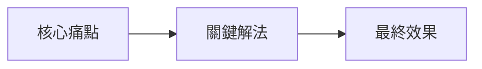

# {title}

> **🎯 一句話結論**：[≤45 字白話直接給出最終答案／核心概念；零鋪陳、零未解釋縮寫、零數學符號]

- **⭐ 推薦度**：{★★★★★ | ★★★★☆ | ★★★☆☆ | ★★☆☆☆ | ★☆☆☆☆}（{≤15 字白話理由}）
- **⚡ 下一步**：[{1 個具體行動 + 明確分鐘數}，或寫「純觀念吸收，無需待辦」]
- **🔗 來源**：[{來源類型}：{author}]({url})

## 💡 核心重點
<!-- Answer First！合併傳統 TL;DR 與學習點，嚴格限制 3–5 條編號短句，禁止寫段落！ -->
<!-- 每條限 1 句話（≤45 字）；若出現專業詞彙，當場括號補 ≤10 字日常類比（Just-in-time context） -->
1. **[核心重點 1]**：[1 句白話因果短句]
2. **[核心重點 2]**：[1 句白話因果短句]
3. **[核心重點 3]**：[1 句白話因果短句]

## 📊 一張表看懂
<!-- 條件式生成：當文章比較 ≥2 個方案、階段或模組時必填（上限 5 列，每格 ≤18 字，把白話類比直接寫進表格） -->
<!-- 若為單一觀點短貼文（如短篇 Threads）或無可對照項目，直接省略整個「📊 一張表看懂」區塊！ -->
| 方案 / 概念 | 卡在哪裡（痛點） | 怎麼解決（白話直覺） | 效果 / 代價 |
|---|---|---|---|
| **[項目 1]** | [≤18 字] | [≤18 字] | [≤18 字] |
| **[項目 2]** | [≤18 字] | [≤18 字] | [≤18 字] |

<!-- 條件式 Mermaid：僅 ★★★★☆ / ★★★★★ 且具明確系統流程時附精簡橫向圖（上限 6 個節點，標籤 ≤10 字）；否則直接省略 -->

---

## 🔍 深入解構（點擊展開細節）
<!-- Explain Later！將原本長篇推導拆成「獨立手風琴（Per-Topic Accordion）」，上限 5 個 
！ -->
<!-- 每個 
 本身就是「編號 + 主題 — 一句白話結論」，讀者點開想看的那一項時，畫面只出現 3 條短 bullet（絕不超過 6 行）！ -->
<!-- 注意：
 後方與 
 前方必須各留一行空白，確保 Markdown 與公式正常渲染！ -->

<!-- 依內容本質自適應每個手風琴內部結構（上限 5 個區塊）： -->
<!-- 1. 系統／教學型（如 CME 295）：拆為「為什麼卡住 / 怎麼解決（含關鍵公式） / 實測數據與代價」3 條短 bullet -->
<!-- 2. 論點推導型（觀點長文／論文）：拆為「核心前提 / 關鍵證據與數據 / 適用邊界」2–3 條短 bullet -->
<!-- 3. 多則情報型（新聞電子報）：每則新聞獨立 1 個 
，內含「發生什麼事 / 關鍵數據與影響」2 條短 bullet -->

<b>1. [模組 / 論點 / 訊號 1]</b> — [≤25 字一句話白話結論]

- **為什麼卡住**：[1 句短句；首次出現之術語直接括號附 ≤10 字類比]
- **怎麼解決**：[1–2 句短句；精確公式與架構機制集中放這裡]
- **數據與代價**：[1 句短句；Benchmark 數據與工程權衡放這裡]

<b>2. [模組 / 論點 / 訊號 2]</b> — [≤25 字一句話白話結論]

- **為什麼卡住**：[1 句短句]
- **怎麼解決**：[1–2 句短句]
- **數據與代價**：[1 句短句]

🧭 <b>對我的意義與來源資訊</b>（Personal Relevance & Metadata）

- **目標關聯（`$DATA_REPO/data/goals.md`）**：[1–2 句點出解決了什麼個人痛點或面試／系統設計價值]
- **延伸靈感／趨勢**：[選填（≤★★★☆☆ 或短貼文省略）：1–2 句可遷移做法或二階效應]
- **⚠️ 免責聲明**：[僅在預告版截斷或數據缺漏時保留；若完整清晰請刪除此行]
- **來源紀錄**：處理時間 `{timestamp}` · `{YouTube: Whisper 模型與片長 | Newsletter: 信件主旨與發信日期 | Threads: 互動數據 | Website: Domain 與發布日期}`（若有任務 ID 附 `· Task ID: {task_id}`）

<!-- 原始內容：僅 YouTube 與 Threads 保留並收折於此；Newsletter 與 Website 完全省略！ -->

📄 <b>展開原始內容</b>（Raw Content — 僅 YouTube / Threads）

[Verbatim transcript or Threads post]

