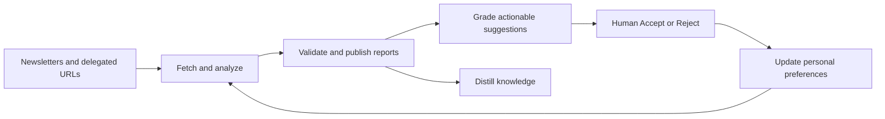

# Knowledge Loop

Learn from technical news, decide which ideas are useful, and improve future recommendations through real feedback.

Knowledge Loop is a public Home Repo: one clone supplies the news-learning skills, six worker personas, shared templates and helpers. External command-line tools are installed separately. Reports and personal state belong outside this checkout in independently configured storage.

## Start on macOS

Follow [the complete setup guide](docs/setup.md). The quick path is:

```bash
git clone '<HOME_REPOSITORY_URL>' knowledge-loop
cd knowledge-loop
python3.12 -m venv .venv
source .venv/bin/activate
python -m pip install -r requirements-dev.txt
python scripts/check_setup.py --offline
```

Replace the repository URL before running. Python 3.10–3.12 is the initial target, matching the inspected transcription tool's range. No global skill installation or additional skill repository is required. [Setup](docs/setup.md) explains external configuration, personal templates, tools, authentication and verification.

## Learning loop



Acceptance records feedback and calibrates recommendations. It does not implement an idea, create an external issue, subscribe/unsubscribe, or change schedules without a separate request.

| Purpose | Bundled skills |
|---|---|
| Orchestration | `daily-workflow` |
| Ingestion | `ingest-newsletter`, `ingest-threads`, `ingest-website`, `ingest-youtube` |
| Shared analysis | `content-summary`, `content-cleaner`, `tech-deconstructor`, `study-github-repo` |
| Extraction | `fetch-threads-post`, `web-to-markdown`, `yt2doc` |
| Feedback and synthesis | `rubric-grader`, `review-suggestions`, `review-newsletter-subscriptions`, `daily-distiller` |
| Required tool guidance | `agent-browser`, `gws-shared`, `gws-gmail`, `gws-tasks` |
| Technical documentation and maintenance | `agent-rules-reviewer`, `skill-context-refactor`, `evolution-log`, `architecture-decision-records` |

Hiring, outcome/evidence logging, diaries, personal writing and general decision coaching are outside this project's scope.

## Storage and privacy

Set `KNOWLEDGE_LOOP_CONFIG` to a JSON file outside the checkout. [The public example](data/repositories.example.json) contains placeholders; relative paths in an operational config resolve from that file's directory. There is no author-specific fallback.

- `report_repository` is an independent Git root. Reports remain under its `reports/` directory.
- `personal_data` contains goals, language, preferences, blocklists, suggestions and prompts. Existing locations are supported.
- `expected_origin` optionally pins the report repository; `timezone` optionally selects an IANA zone.
- Public `data/*.md` files are neutral seed templates, never active personal state.
- Content-workflow scratch lives under the external report repository's `.tmp/knowledge-loop/`. Home Repo scratch, virtual environments and caches are ignored. Private config, accounts, raw captures and runtime data must never be committed, including in examples or archives.

The [storage protocol](.agents/skills/content-summary/references/storage.md) covers receipts, idempotency, source acknowledgement and revisions. Historical report paths are preserved. All Git operations are separate and explicit; stored files need not be committed to count as durable local output.

## Agent discovery

Start Codex in this repository. It discovers `.agents/skills` and project agents in `.codex/agents`. Canonical persona sources are `.agents/agents`; `scripts/sync_subagents.py` generates platform adapters. Read the destination repository's `AGENTS.md` explicitly before cross-repository writes. Merely registering another repository does not load its instructions or grant write access.

The primary target is Codex on macOS. Parallel workflows need fresh worker contexts. Website skills need the documented URL-fetch capability; use the documented `curl` route when the host lacks a native fetch tool. Antigravity hook configuration is retained for that harness and is not assumed to run in Codex.

## Verification

```bash
python3 scripts/check_setup.py --offline
python3 scripts/validate_skill.py
python3 scripts/validate_public.py
PYTHONDONTWRITEBYTECODE=1 python3 -m pytest -q -p no:recording -p no:cacheprovider tests
python3 scripts/sync_subagents.py --check
```

Tests use synthetic reports, private-state fixtures, arbitrary checkout names and paths with spaces. They do not require account access or another repository checkout. See [the migration plan](docs/plan/home-repo-migration-plan.md) for acceptance, cutover and remaining live verification gates.

## Project records

- [Operating contract](AGENTS.md)
- [Architecture and migration decisions](docs/rfc/home-repo-architecture.md)
- [Implementation and cutover status](docs/plan/home-repo-migration-plan.md)
- [Backlog](backlog.md)
- [Known environment issues](known_issues.md)
- [Third-party provenance](THIRD_PARTY.md)
