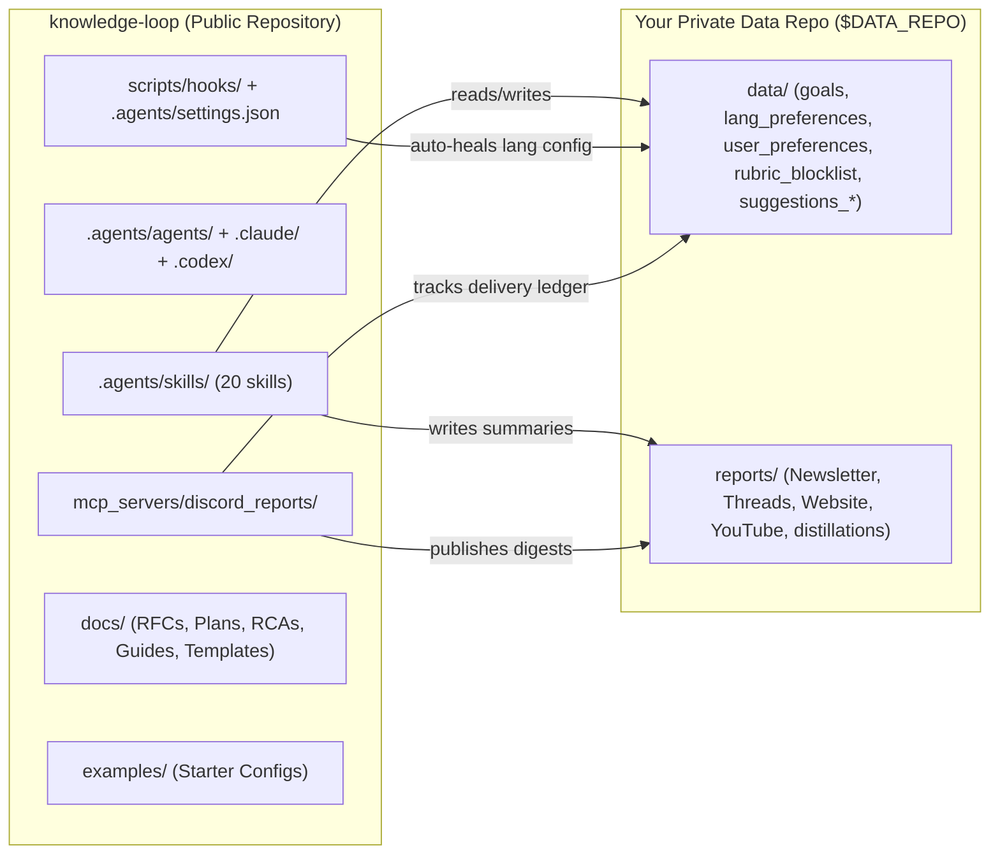

# Knowledge Loop

A portable, open-source `knowledge-loop` repository implementing the [Home Repo Pattern](https://www.aihero.dev/the-home-repo-pattern) for an agentic **daily content-intelligence pipeline** (`daily-workflow`).

`knowledge-loop` holds all reusable agent skills, cross-platform sub-agent personas, lifecycle hooks, the local `discord-reports` MCP server, architecture RFCs/RCAs, and starter configuration examples — with **zero personal data** and **zero hardcoded absolute paths**. Your personal goals, preferences, reports, and suggestion history live in your own private **Data Repo** (`$DATA_REPO`).

---

## Architecture: knowledge-loop + Private Data Repo



### How `$DATA_REPO` Resolves (Zero Absolute Paths)
Scripts, hooks, and the `discord-reports` MCP server resolve `$DATA_REPO` automatically via `scripts/lib/workspace_paths.py` and `scripts/lib/resolve_data_repo.sh`:
1. Explicit `--data-repo <path>` flag (when supported)
2. `KNOWLEDGE_LOOP_DATA_REPO` environment variable
3. `DATA_REPO_DIR` inside gitignored `./workspace.local.env`
4. Single-repo fallback: `.` if `./data/` exists locally

---

## Quickstart (macOS)

See the full walkthrough in [Setup Guide](docs/guides/setup-guide.md).

### 1. Clone & Initialize Your Workspace
```bash
git clone <YOUR_KNOWLEDGE_LOOP_REPO_URL> knowledge-loop
cd knowledge-loop

# Link an existing private Data Repo or scaffold a new one (never overwrites existing files)
./scripts/init_workspace.sh --data-repo ../my-knowledge-data --with-code-workspace
```

### 2. Install Prerequisites (macOS)
- **Python 3.10+** & **`uv`** (`brew install uv`)
- **Google Workspace CLI (`gws`)** for Gmail newsletters & Google Tasks:
  ```bash
  brew tap googleworkspace/cli && brew install gws
  gws auth setup && gws auth login
  ```
- **YouTube Transcription (`yt2doc`)**: `uv tool install yt2doc`
- **Browser Automation (`agent-browser`)**: optional for authenticated Threads scraping

### 3. Open as a Multi-Root Workspace
Open the generated gitignored `knowledge-loop.code-workspace` in your IDE (Antigravity / Cursor / VS Code), or pass `--add-dir ../my-knowledge-data` in CLI agents (Claude Code / Codex) so sandboxed tools have authorized access to both repositories.

### 4. Configure Optional Discord Delivery
Follow [Discord & MCP Setup Guide](docs/guides/discord-mcp-setup-guide.md) and copy [examples/mcp_config.example.json](examples/mcp_config.example.json) into your MCP client config (`~/.gemini/config/mcp_config.json`), setting `KNOWLEDGE_LOOP_DATA_REPO` and `DISCORD_WEBHOOK_URL`.

---

## Included Skills Catalog (20 Skills)

| Layer | Skills | Purpose |
| :--- | :--- | :--- |
| **Orchestrator (1)** | `daily-workflow` | End-to-end daily pipeline: discover Gmail/Tasks → dispatch parallel workers → grade suggestions → distill → deliver to Discord → interactive review |
| **Ingestion (4)** | `ingest-newsletter`, `ingest-threads`, `ingest-website`, `ingest-youtube` | Source-specific fetch, summarize, report write, and task/email completion |
| **Core Loop (5)** | `content-summary`, `rubric-grader`, `daily-distiller`, `deliver-discord-reports`, `review-suggestions` | Shared Answer-First Pyramid summarization, 3-dimension suggestion scoring, cross-source distillation, Discord delivery, and preference calibration |
| **Extraction Helpers (4)** | `content-cleaner`, `fetch-threads-post`, `web-to-markdown`, `yt2doc` | Pure article extraction, Threads SPA scraping, Jina Reader conversion, and Whisper transcription |
| **Companion Workflows (2)** | `review-newsletter-subscriptions`, `evolution-log` | 30-day newsletter ROI audit & narrative project evolution chronicler |
| **CLI Adapters (4)** | `agent-browser`, `gws-gmail`, `gws-shared`, `gws-tasks` | External tool instructions tracked in `skills-lock.json` |

---

## Verification & Public Hygiene Tests

```bash
# 1. Verify zero PII, zero absolute paths, and zero broken internal links
python3 scripts/audit_public_repo.py

# 2. Validate all 20 SKILL.md manifests & cross-platform persona sync
python3 scripts/validate_skill.py && python3 scripts/sync_subagents.py

# 3. Run the full offline test suite (uses isolated temp Data Repo fixtures)
python3 -m pytest -p no:recording tests/ -v
```

---

## Documentation
- [Evolution Log](EvolutionLog.md)
- [Setup Guide](docs/guides/setup-guide.md)
- [Discord & MCP Setup Guide](docs/guides/discord-mcp-setup-guide.md)
- [Home Repo Pattern RFC & ADR](docs/rfc/home-repo-pattern-architecture.md)
- [Cognitive Bandwidth Protection Guide](docs/cognitive_bandwidth_protection_guide.md)
- [Templates](docs/templates/) (`rfc_template.md`, `plan_template.md`, `rca_template.md`, `prd_template.md`)
