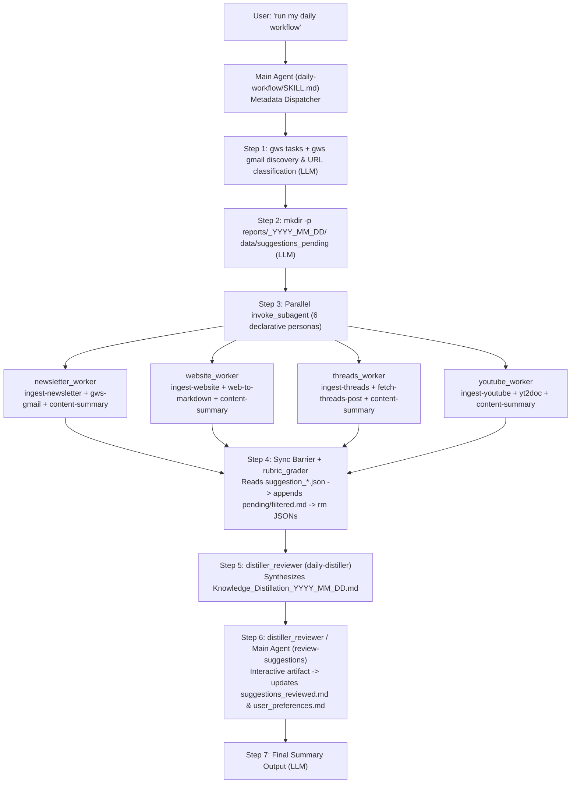
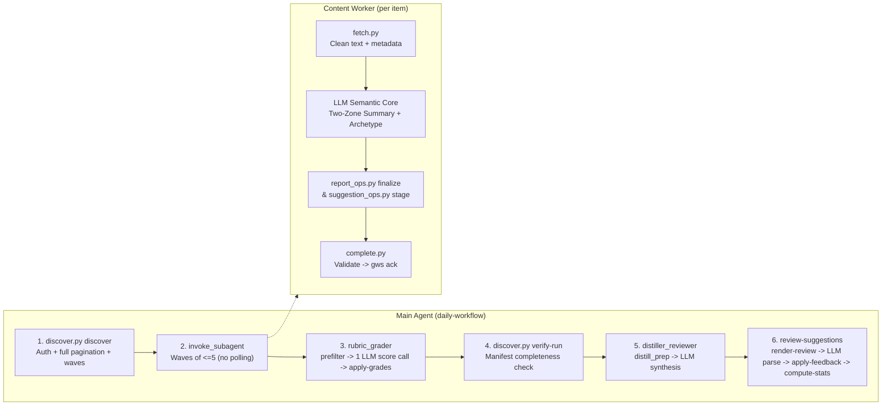

# Audit Report: Deterministic Execution Opportunities in `daily-workflow` and Related Agent Skills

- **Evaluation Date**: 2026-11-20
- **Scope**: [`daily-workflow`](../.agents/skills/daily-workflow/SKILL.md) and all related ingestion, summarization, grading, distillation, review, and tool-wrapper Agent Skills
- **Mode**: Read-only evaluation (no skills, scripts, workflows, or configurations modified)
- **Evidence Basis**:
  - Static inspection of 16 skills, 6 subagent personas ([`.agents/agents/`](../.agents/agents)), repo scripts/hooks ([`scripts/`](../scripts), [`.agents/settings.json`](../.agents/settings.json)), tests ([`tests/`](../tests)), and [`known_issues.md`](../known_issues.md)
  - Forensic review of 23 historical RCAs in [`docs/rca/`](rca) and prior deprecated runtime RFC/patch history (commits `0274387` and `29724bc`)
  - Empirical runtime telemetry from **24 Antigravity `daily-workflow` execution transcripts** (2026-10-28 through 2026-11-20; 22 productive runs + 2 auth-blocked runs, encompassing **262 subagent runs**)

---

## 1. Executive Summary

The `daily-workflow` content intelligence pipeline has evolved into a clean parallel fan-out architecture (pure metadata orchestrator + 6 declarative subagent personas), yet **nearly all predictable mechanical execution remains delegated to the LLM**. Across all 16 skills in the `daily-workflow` ecosystem, only **one** 32-line helper script ([`fetch-thread.sh`](../.agents/skills/fetch-threads-post/scripts/fetch-thread.sh)) exists inside a skill directory, and **zero** production CLI utilities handle discovery, pagination, fetching, HTML cleaning, schema validation, deterministic suggestion routing, crash-safe completion, or statistical preference recomputation.

### Headline Empirical Findings (24 Daily Runs, 262 Subagents)

1. **Substantial mechanical LLM overhead every day**: A typical productive run (median **11 subagents**) consumes a median of **2.07M uncached input tokens**, **21.01M cache-read tokens**, and **256.8K output tokens** across **~460 LLM turns** (orchestrator median 65 calls + 11 workers × 25–51 calls), taking a median **35.5 minutes** wall-clock (mean 62.7 min) vs. the 8–15 minute target documented in [`daily-workflow/README.md`](../.agents/skills/daily-workflow/README.md#L21).
2. **1,157 ad-hoc `python3` commands synthesized on the fly**: Workers repeatedly write throwaway Python scripts to fill missing deterministic utilities—most notably **595 calls** importing [`tests/test_suggestion_payload_schema.py`](../tests/test_suggestion_payload_schema.py) as an impromptu runtime validator and **136 calls** writing inline HTML/base64 cleaners for Gmail responses.
3. **Repeated Gmail fetches & raw HTML bloat**: `newsletter_worker` (181 of 262 subagents, 69%) averages **2.7 Gmail reads per single email** (495 reads total; median 3/email) due to `gws` macOS keyring/redirection friction and multipart HTML truncation, pulling raw HTML payloads (28–111 KB) into context.
4. **Unenforced invariants cause recurring pipeline failures**: Historical RCAs and recent runs document hallucinated URLs/task IDs ([`daily_workflow_rca_2026-06-03_V1.md`](rca/daily_workflow_rca_2026-06-03_V1.md)), stale `.tmp/` cache reuse ([`daily_workflow_rca_2026-06-18_V1.md`](rca/daily_workflow_rca_2026-06-18_V1.md)), forgotten completed background YouTube transcripts ([`ingest_youtube_rca_2026-06-03_V1.md`](rca/ingest_youtube_rca_2026-06-03_V1.md)), silent truncation at 10 unread newsletters (`2026-11-05` and `2026-11-13` runs), and 8 OAuth token-expiry halts (6 RCAs + 2 recent runs).
5. **Non-deterministic arithmetic on a 755 KB review log**: [`review-suggestions/SKILL.md`](../.agents/skills/review-suggestions/SKILL.md#L114-L191) and [`rubric-grader/SKILL.md`](../.agents/skills/rubric-grader/SKILL.md#L36-L93) delegate exact arithmetic (14-day 2× recency-weighted acceptance rates, >30% drift detection, confusion-matrix backtests, score-bucket calibration) over the **957-entry / 755 KB** [`data/suggestions_reviewed.md`](../data/suggestions_reviewed.md) directly to the LLM.

### Core Recommendation

Adopt **Hybrid Option B: Shared Execution Utilities (`scripts/content_pipeline/`) with thin skill contracts and boundary invariant enforcement**—rather than rebuilding a heavyweight centralized state-machine orchestrator (Option C, which was previously designed in commit `0274387` and removed in `29724bc`). Five focused, idempotent Python utilities (~900–1,100 lines total) paired with immediate zero-code prompt hygiene can eliminate an estimated **33–48% of daily uncached input tokens**, **36–48% of LLM turns**, and **6–11 minutes of wall-clock latency**, while keeping all genuine semantic synthesis, editorial judgment, and adaptive error diagnosis with the LLM.

---

## 2. Current Workflow Architecture

### 2.1 End-to-End Execution Topology

### 2.2 Documented vs. Code-Enforced vs. LLM-Delegated vs. Observed Behavior

| Aspect | Documented Behavior | Enforced by Code Today? | Delegated to LLM | Observed Runtime Reality (24 Transcripts & 23 RCAs) |
|---|---|---|---|---|
| **Auth & Sandbox Preflight** | [`gws-shared/SKILL.md`](../.agents/skills/gws-shared/SKILL.md) + [`known_issues.md`](../known_issues.md#L6-L11) (`GOOGLE_WORKSPACE_CLI_KEYRING_BACKEND=file`) | **No** | Yes | Fails mid-step on OAuth expiry (6 RCAs + 2 recent runs on `11-03`, `11-20`) or macOS OS keyring denial; workers retry `gws` 2–4× per email. |
| **Queue Discovery & Pagination** | [`daily-workflow/SKILL.md`](../.agents/skills/daily-workflow/SKILL.md#L28-L44) Step 1 (`maxResults: 1` probe) + Step 3 ("batches of 10") | **No** | Yes | Orchestrator frequently queries `maxResults: 10` and stops after 10 newsletters (`2026-11-05`, `2026-11-13`), requiring manual user prompts (`"process all unread newsletter"`) to ingest the remaining 8–11 items. |
| **Queue Integrity / Scope** | Process only discovered `Delegate` tasks and unread newsletters | **No** | Yes | Hallucinated Lilian Weng URL + fabricated Google Task ID processed in [`daily_workflow_rca_2026-06-03_V1.md`](rca/daily_workflow_rca_2026-06-03_V1.md); stale `.tmp/facebook_body.txt` reused 10 days later in [`daily_workflow_rca_2026-06-18_V1.md`](rca/daily_workflow_rca_2026-06-18_V1.md). |
| **Parallel Dispatch & Timeout** | [`daily-workflow/README.md`](../.agents/skills/daily-workflow/README.md#L17) specifies fire-and-forget + 30-min global timeout; [`known_issues.md`](../known_issues.md#L13) warns 7+ parallel triggers 429 | **No** | Yes | `SKILL.md` specifies neither a timeout nor a concurrency cap. Orchestrators ad-hoc wave-batch (4–5/wave) and poll `manage_subagents` (35 calls) + `ls` (29 calls) during wait phase. |
| **Worker Instruction Loading** | Skills reference `content-summary/references/*.md` + `data/*.md` | **No** | Yes | Each worker reads **8.5–9.9 static files** (22–27 KB) individually per run (~100 redundant reads/day), plus occasional reads of `docs/rfc/parallel-content-processing.md` (79×) and `tests/test_suggestion_payload_schema.py` (71×). |
| **Language Config Integrity** | `data/lang_preferences.md` checked before report/distillation writing | **Partially** ([`ensure_lang_preferences.sh`](../scripts/hooks/ensure_lang_preferences.sh) hook auto-repairs file existence/keys) | Report language adherence | Hook ensures file existence and required keys; does not verify output report language. |
| **Suggestion Staging vs. Direct Grading** | `daily-workflow` stages JSON to `data/suggestions_pending/`; [`ai_analysis.md`](../.agents/skills/content-summary/references/ai_analysis.md#L84-L92) still says "Use `rubric-grader` skill" | **No** (`test_suggestion_payload_schema.py` is a test file, not a CLI gate) | Yes | Contradictory instructions cause ingestion workers to read `rubric_blocklist.md` (128×) and `rubric.md` (47×), run 595 ad-hoc Python schema checks, and shell-touch `suggestions_*.md` directly in 9 instances. |
| **Rubric Hard-Vetoes & Routing** | [`rubric-grader/SKILL.md`](../.agents/skills/rubric-grader/SKILL.md#L18-L33) checks `TAKEAWAY_ONLY`, ambiguity phrases, topic blocks, composite score ≥ 4/6 | **No** | Yes | `rubric_grader` spends median **32 model calls / 1.80M prompt tokens** per run doing JSON loading, literal string checks, `A+P+G` addition, markdown formatting, and `rm` cleanup. |
| **Persona Sync & Skill Validation** | [`AGENTS.md`](../AGENTS.md) mandates `validate_skill.py` + `sync_subagents.py` | **Yes** (`AfterTool` hook in [`.agents/settings.json`](../.agents/settings.json#L20-L34)) | Triggered automatically on edits | Enforced deterministically. Minor doc drift: `daily-workflow/README.md` still refers to `.agents/subagents/*.md` whereas actual source files live in `.agents/agents/*.md`. |
| **Dangerous Command Guard** | Block `git push --force` and `rm -rf /` | **Yes** (`BeforeTool` hook [`prevent_dangerous_commands.sh`](../scripts/hooks/prevent_dangerous_commands.sh)) | — | Enforced deterministically on every `run_command`. |

### 2.3 Historical RCA Failure-Mode Traceability

| Failure Category | RCA Evidence | Preventable / Detectable by Code? | Proposed Code Fix Enforced Today? |
|---|---|---|---|
| **Hallucinated input / scope drift** | [`daily_workflow_rca_2026-06-03_V1.md`](rca/daily_workflow_rca_2026-06-03_V1.md) | **Yes** — assert dispatched URL/task ID ∈ discovered manifest | **Missing** (no runtime queue assertion exists) |
| **Stale cache reuse** | [`daily_workflow_rca_2026-06-18_V1.md`](rca/daily_workflow_rca_2026-06-18_V1.md) | **Yes** — task-ID scoped cache paths + fresh fetch timestamp | **Missing** (Backlog Items #29 & #30 never implemented) |
| **Skipped pipeline step / forgotten job** | [`ingest_youtube_rca_2026-06-03_V1.md`](rca/ingest_youtube_rca_2026-06-03_V1.md) | **Yes** — completion barrier verifying every manifest item before distillation | **Missing** (no pipeline completion assertion exists) |
| **Environment / OAuth / keyring failures** | 6 OAuth RCAs (`2026-09-20`, `09-29`, `10-07`, `10-15`, `10-26`, `11-04`), [`daily_workflow_rca_2026-09-04_V1.md`](rca/daily_workflow_rca_2026-09-04_V1.md), [`gws_shared_rca_2026-06-14_V1.md`](rca/gws_shared_rca_2026-06-14_V1.md), [`daily_workflow_rca_2026-07-29_V1.md`](rca/daily_workflow_rca_2026-07-29_V1.md) | **Partially** — deterministic preflight (`gws auth status` + `GOOGLE_WORKSPACE_CLI_KEYRING_BACKEND=file`) detects auth expiry cleanly in 1 call before dispatch; cannot auto-refresh expired OAuth tokens | **Missing** (workaround only documented in `known_issues.md`) |
| **Output format / schema / language drift** | [`daily_workflow_rca_2026-07-31_V2.md`](rca/daily_workflow_rca_2026-07-31_V2.md), [`daily_workflow_rca_2026-09-03_V1.md`](rca/daily_workflow_rca_2026-09-03_V1.md), [`newsletter_summary_rca_2026-05-13_V1.md`](rca/newsletter_summary_rca_2026-05-13_V1.md) | **Yes (structural)** — header/section validator & `ensure_lang_preferences.sh` | **Partial** (`ensure_lang_preferences.sh` exists; `scripts/validate_individual_reports.py` referenced in `2026-05-13` RCA no longer exists) |
| **Source content truncation** | [`ingest-newsletter_rca_2026-05-15_V1.md`](rca/ingest-newsletter_rca_2026-05-15_V1.md), [`newsletter_summary_rca_2026-04-02_V1.3.0.md`](rca/newsletter_summary_rca_2026-04-02_V1.3.0.md), [`newsletter_summary_rca_2026-04-02_V1.4.0.md`](rca/newsletter_summary_rca_2026-04-02_V1.4.0.md) | **Yes** — deterministic MIME/HTML extractor + non-empty/header checks | **Missing** (prompt change `--html` only; LinkedIn truncation later resurfaced in `known_issues.md` L7) |
| **Subagent tool config mismatch** | [`daily_workflow_rca_2026-07-31_V1.md`](rca/daily_workflow_rca_2026-07-31_V1.md) | **Yes** — schema check in `sync_subagents.py` | **Exists** (`sync_subagents.py` runs via `AfterTool` hook) |
| **Semantic gaming (Prompt Monoculture)** | [`daily_workflow_rca_2026-09-29_V2.md`](rca/daily_workflow_rca_2026-09-29_V2.md) | **Partially** — enum prefix validation in code; semantic Forced Prompt Wrapping detection stays with LLM | **Partial** (tested via [`tests/test_suggestion_archetypes.py`](../tests/test_suggestion_archetypes.py), not enforced at runtime) |
| **YouTube runtime / bot detection / Docker** | [`daily-workflow_rca_2026-05-13_V1.md`](rca/daily-workflow_rca_2026-05-13_V1.md), [`yt2doc_rca_2026-05-14_V1.md`](rca/yt2doc_rca_2026-05-14_V1.md), [`yt2doc_rca_2026-05-14_V2.md`](rca/yt2doc_rca_2026-05-14_V2.md) | **Partially** — deterministic duration→model selector & exit-code classifier | **Missing** (prompt table only; Docker replaced by local `yt2doc`) |

---

## 3. Workflow Inventory *(Deliverable 1)*

All 16 skills directly in or supporting the `daily-workflow` pipeline (plus adjacent consumer skill and repo-level governance scripts):

| Workflow / Skill | Entry Point | Trigger Conditions | Inputs | Outputs | Dependencies | Existing Scripts / Tools | LLM Responsibilities | Failure Handling | Completion Conditions |
|---|---|---|---|---|---|---|---|---|---|
| **daily-workflow** | [`SKILL.md`](../.agents/skills/daily-workflow/SKILL.md) (98L) + [`dispatch_spec.md`](../.agents/skills/daily-workflow/references/dispatch_spec.md) (110L) | "run my daily workflow", "run daily", "start my daily routine" | Google Tasks `Delegate` list; Gmail `label:newsletter is:unread` | Reports, merged suggestions, distillation, review artifact, final summary | `ingest-*`, `rubric-grader`, `daily-distiller`, `review-suggestions`, `gws-*` | `gws` CLI (no repo scripts) | Run discovery commands, parse/classify URLs, create dirs, build dispatch messages, wait/track completions, invoke grader/distiller/reviewer, print summary | Early exit if empty; fail-fast on auth error; no enforced timeout/checkpoint | All dispatched items terminal, suggestions merged, distillation saved, review presented, summary printed |
| **ingest-newsletter** | [`SKILL.md`](../.agents/skills/ingest-newsletter/SKILL.md) (103L) | Standalone ("幫我整理電子報") or via `newsletter_worker` | `MESSAGE_ID` (opt.), `SuggestionOutputPath` (opt.), `Report directory` | `reports/Newsletter_YYYY_MM_DD/<file>.md`, suggestion JSON, Gmail message marked read+archived | `gws-gmail`, `gws-shared`, `content-summary`, `data/*.md` | `gws` CLI (no repo scripts) | Fetch email (`+read --html`), verify headers, strip HTML/fluff, summarize, write report & suggestion JSON, modify Gmail labels | Retry if `From`/`Subject` truncated; fallback to `messages get` + base64 (`known_issues.md`); mark read only after report written | Report written, suggestion staged, email `UNREAD`/`INBOX` removed |
| **ingest-website** | [`SKILL.md`](../.agents/skills/ingest-website/SKILL.md) (91L) | Generic URL task or via `website_worker` | `WEBSITE_URL`, `TASK_ID`, `DELEGATE_LIST_ID`, `SuggestionOutputPath` | `reports/Website_YYYY_MM_DD/[domain]_[slug].md`, suggestion JSON, Google Task completed | `web-to-markdown`, `content-cleaner`, `content-summary`, `gws-tasks` | `read_url_content` / `curl` to `r.jina.ai`, `gws` CLI | Fetch via Jina (or fallback to `content-cleaner`), summarize, sanitize filename, write report & suggestion JSON, patch task completed | Fallback to `content-cleaner`; if both fail, log & skip without marking done; rewrite `x.com`→`twitter.com` | Report written, suggestion staged, task patched `completed` |
| **ingest-threads** | [`SKILL.md`](../.agents/skills/ingest-threads/SKILL.md) (89L) | Threads URL task or via `threads_worker` | `THREADS_URL`, `TASK_ID`, `DELEGATE_LIST_ID`, `SuggestionOutputPath` | `reports/Threads_YYYY_MM_DD/<file>.md` (incl. verbatim raw post), suggestion JSON, Google Task completed | `fetch-threads-post`, `content-summary`, `gws-tasks` | `agent-browser`, `gws` CLI | Browser navigation/expansion/extraction, anti-truncation check, summarize, write report & suggestion JSON, patch task completed | Retry if truncated; load `threads-auth.json` on login wall; Jina fallback (`known_issues.md`) | Report written, suggestion staged, task patched `completed` |
| **ingest-youtube** | [`SKILL.md`](../.agents/skills/ingest-youtube/SKILL.md) (118L) | YouTube URL task or via `youtube_worker` | `YOUTUBE_URL`, `TASK_ID`, `DELEGATE_LIST_ID`, `SuggestionOutputPath` | `reports/YouTube_YYYY_MM_DD/<file>.md` (incl. raw transcript), suggestion JSON, Google Task completed, raw temp removed | `yt2doc`, `content-summary`, `gws-tasks` | `yt2doc`, `yt-dlp`, `gws` CLI | Look up duration, pick Whisper model from table, run & poll `yt2doc`, check exit code & non-empty file, summarize, write report & suggestion JSON, mark done & `rm` temp | Exit 137/9 OOM report (do not mark done); show last 20 lines of stderr on other errors | Report written, suggestion staged, task completed, raw `<video_id>.md` deleted |
| **content-summary** *(shared reference library)* | [`SKILL.md`](../.agents/skills/content-summary/SKILL.md) (20L) + 5 files in [`references/`](../.agents/skills/content-summary/references) (349L) | Referenced by all 4 `ingest-*` skills | Source content + `data/goals.md`, `data/lang_preferences.md`, `data/user_preferences.md` | Rules for report structure, Two-Zone CoT, 5 Action Archetypes, filename sanitization, suggestion schema | `data/*.md` | None (unit tests only in [`tests/`](../tests)) | All reading, formatting, filename sanitization, 6-point self-verification, archetype selection | Teaser disclaimer if short; zero fabrication | — (shared reference library) |
| **rubric-grader** | [`SKILL.md`](../.agents/skills/rubric-grader/SKILL.md) (93L) + [`rubric.md`](../.agents/skills/rubric-grader/references/rubric.md) (63L) | Step 4 (`rubric_grader`), Backtest mode, Maintain mode (from `review-suggestions` Step 6-6) | `data/suggestions_pending/suggestion_*.json`, `data/rubric_blocklist.md`, `data/user_preferences.md`, `data/goals.md`, `data/suggestions_reviewed.md` | Appends to `suggestions_pending.md` or `suggestions_filtered.md`; deletes JSONs; `.tmp/rubric_backtest_report.md`; blocklist proposals | `content-summary`, `data/*.md` | None | Load JSONs, check topic/ambiguity blocklists + `TAKEAWAY_ONLY`, score A/P/G (0–2), sum total, route ≥4 vs <4, format markdown, delete JSONs; compute TP/FP/TN/FN & score-bucket rates | None documented for malformed JSON or partial failure | All staged JSONs graded, routed, and deleted |
| **daily-distiller** | [`SKILL.md`](../.agents/skills/daily-distiller/SKILL.md) (52L) + [`output_template.md`](../.agents/skills/daily-distiller/assets/output_template.md) (77L) | Step 5 (`distiller_reviewer`) or standalone ("distill today's knowledge") | Today's `.md` files in `reports/` (excluding `distillations/`), `data/lang_preferences.md` | `reports/distillations/Knowledge_Distillation_YYYY_MM_DD.md` | `data/lang_preferences.md` | `find` shell command | Discover today's reports, read all in full, synthesize 2–4 cross-cutting Pillars + Synthesis + Strategic Takeaway, write file | Stop & notify if no reports found | Distillation markdown saved with today's local date |
| **review-suggestions** | [`SKILL.md`](../.agents/skills/review-suggestions/SKILL.md) (212L) | Step 6 (`distiller_reviewer` / main agent) or standalone ("review my suggestions") | `data/suggestions_pending.md`, `data/suggestions_reviewed.md`, `data/user_preferences.md`, user feedback | Feedback artifact (`RequestFeedback: true`), updated `suggestions_pending.md`, appended `suggestions_reviewed.md`, regenerated `user_preferences.md` | `rubric-grader` (Maintain mode) | None | Parse markdown entries, split today vs backlog, render numbered artifact, parse free-text feedback, move entries, recompute 14-day 2× weighted stats & >30% shifts over 957 entries, cluster action types, run Maintain mode | Stop if no pending entries; unmentioned items preserved | Reviewed entries moved, profile regenerated, Maintain mode run, user confirmed |
| **fetch-threads-post** | [`SKILL.md`](../.agents/skills/fetch-threads-post/SKILL.md) (263L) | Called by `ingest-threads` or standalone | Threads URL, optional `threads-auth.json` | Structured markdown (Author, Content, Media, Engagement, Timestamp, Replies) | `agent-browser` | [`fetch-thread.sh`](../.agents/skills/fetch-threads-post/scripts/fetch-thread.sh) (32L; basic dump lacking session parameterization/scroll/Read more) | Navigate, `snapshot -i`, detect login wall/CAPTCHA, click "Read more", extract DOM refs/body, scroll replies loop, close session | Load saved auth state; screenshot CAPTCHA & halt; fallback `get text body` | Full post & replies extracted and browser session closed |
| **web-to-markdown / content-cleaner** | [`web-to-markdown/SKILL.md`](../.agents/skills/web-to-markdown/SKILL.md) (44L), [`content-cleaner/SKILL.md`](../.agents/skills/content-cleaner/SKILL.md) (36L) | Called by `ingest-website` or standalone | URL or raw HTML/text | Clean Markdown | `read_url_content`, `r.jina.ai` | None | Validate URL, prepend `https://r.jina.ai/`, parse Jina metadata/body, or strip HTML/ads/nav via LLM | Fallback from Jina to `content-cleaner` | Clean markdown extracted |
| **yt2doc** | [`SKILL.md`](../.agents/skills/yt2doc/SKILL.md) (135L) | Called by `ingest-youtube` or standalone | YouTube URL | `reports/YouTube_YYYY_MM_DD/<video_id>.md` | Local `yt2doc`, `yt-dlp` | `yt2doc`, `yt-dlp` CLIs | Duration lookup, model-table lookup, async invocation & polling, exit-code diagnosis | Exit 137/9 OOM advice; retry on `ChunkedEncodingError` | Exit 0 & non-empty `.md` file |
| **gws-gmail / gws-tasks / gws-shared** | [`gws-gmail`](../.agents/skills/gws-gmail/SKILL.md) (61L), [`gws-tasks`](../.agents/skills/gws-tasks/SKILL.md) (57L), [`gws-shared`](../.agents/skills/gws-shared/SKILL.md) (84L) | Prerequisite CLI docs for discovery & state mutations | API params/JSON | Gmail/Tasks JSON responses | `gws` CLI v0.22.5 | `gws` binary | Construct CLI flags/JSON payloads | Manual `gws auth login` on expiry | API call succeeds |
| **Repo Governance & Adjacent Consumer** | [`.agents/settings.json`](../.agents/settings.json), [`review-newsletter-subscriptions/SKILL.md`](../.agents/skills/review-newsletter-subscriptions/SKILL.md) | Tool hooks + periodic subscription audit | Skill files, `reports/Newsletter_*`, `suggestions_reviewed.md` | Hook pass/block, synced personas, subscription ROI report | Python 3, Bash | [`validate_skill.py`](../scripts/validate_skill.py), [`sync_subagents.py`](../scripts/sync_subagents.py), [`ensure_lang_preferences.sh`](../scripts/hooks/ensure_lang_preferences.sh), [`analyze_subscriptions.py`](../.agents/skills/review-newsletter-subscriptions/scripts/analyze_subscriptions.py) | Hooks run with zero LLM; `review-newsletter-subscriptions` runs deterministic Python analytics then LLM interprets ROI | Fail-fast hook exit code 2 | Validated skills/personas & ROI recommendations |

> **Evidence Coverage Note**: Runtime transcripts empirically cover **Newsletter (181)**, **Website (33)**, **Rubric Grader (24)**, **Daily Distiller (21)**, and **Threads (3)**. **YouTube** (0 runs in 2026-10-28–11-20; 27 historical report directories) and full **`review-suggestions` human-reply loops** (only 1 partial artifact comment on 2026-11-08) are assessed from static definitions, `data/` artifacts (957 reviewed entries), `.tmp/` scripts, and historical RCAs.

---

## 4. Step-Level Responsibility Matrix *(Deliverable 2)*

Classifications: **D** = Deterministic, **L** = LLM Required, **H** = Hybrid (explicitly split below), **U** = Uncertain.

| Workflow | Step | Current Owner | Classification | Recommended Owner | Evidence | Reason |
|---|---|---|---|---|---|---|
| `daily-workflow` | 1a. Verify `gws` auth & keyring env (`GOOGLE_WORKSPACE_CLI_KEYRING_BACKEND=file`) | LLM (ad-hoc, often after failure) | **D** | Code | 6 OAuth RCAs (`2026-09-20`..`11-04`), 2 recent auth-halted runs (`11-03`, `11-20`), [`known_issues.md`](../known_issues.md#L6-L11) | Fixed binary check (`gws auth status` / exit code) with deterministic fail-fast message. |
| `daily-workflow` | 1b. Discover `Delegate` tasklist, paginate all pending tasks & all unread newsletters | LLM (runs `gws` CLI) | **D** | Code | [`daily-workflow/SKILL.md`](../.agents/skills/daily-workflow/SKILL.md#L28-L44); `2026-11-05` & `11-13` runs truncated at 10 emails | Pure API pagination (`--page-all` / `nextPageToken`) and JSON extraction. Eliminates silent 10-item cutoff. |
| `daily-workflow` | 1c. Classify task URLs (`threads`/`youtube`/`website`/`skip`) & check empty early-exit | LLM | **D** | Code | [`dispatch_spec.md`](../.agents/skills/daily-workflow/references/dispatch_spec.md#L9-L18); hallucinated URL in [`daily_workflow_rca_2026-06-03_V1.md`](rca/daily_workflow_rca_2026-06-03_V1.md) | Regex/hostname match table is 100% explicit; emits authoritative manifest preventing hallucinated tasks. |
| `daily-workflow` | 2. Pre-create date-stamped report dirs & `data/suggestions_pending/` | LLM (`mkdir -p`) | **D** | Code | [`daily-workflow/SKILL.md`](../.agents/skills/daily-workflow/SKILL.md#L48-L54) | Pure filesystem setup derived from non-empty queues + local date. |
| `daily-workflow` | 3a. Build dispatch payloads (paths, IDs, concurrency wave grouping ≤5) | LLM | **D** | Code | [`dispatch_spec.md`](../.agents/skills/daily-workflow/references/dispatch_spec.md#L42-L85); [`known_issues.md`](../known_issues.md#L13) (7+ parallel → 429) | Template interpolation + wave slicing (max 5/wave) requires zero reasoning. |
| `daily-workflow` | 3b. Invoke subagent tool calls (`invoke_subagent`) & await completion barrier | Mixed (Host runtime + LLM) | **H** | Host/LLM invokes from Code manifest + Code verifies barrier | `dispatch_wait` phase median 1.12M prompt tokens; 35 `manage_subagents` + 29 `ls` polling calls; [`ingest_youtube_rca_2026-06-03_V1.md`](rca/ingest_youtube_rca_2026-06-03_V1.md) | **LLM/Host**: must call `invoke_subagent` (Python cannot natively invoke Antigravity subagents). **Code**: verifies every manifest item produced expected report + suggestion artifacts before Step 4/5. |
| `daily-workflow` | 7. Format final execution summary | LLM | **D** | Code | [`dispatch_spec.md`](../.agents/skills/daily-workflow/references/dispatch_spec.md#L89-L110) | Deterministic template rendered from manifest + produced report/suggestion statuses. |
| `ingest-newsletter` | 2-1. Fetch email (`+read --html` or `messages get` base64 fallback), verify `From`/`Subject`, strip HTML/tracking boilerplate | LLM (`gws` + inline `python3`) | **D** | Code | 495 Gmail reads for 181 emails (median 3/email); 136 ad-hoc HTML-cleaning Python scripts; [`known_issues.md`](../known_issues.md#L7); [`daily_workflow_rca_2026-09-04_V1.md`](rca/daily_workflow_rca_2026-09-04_V1.md) | MIME parsing, header validation, base64 fallback, and HTML-to-text extraction are standard deterministic operations. |
| `ingest-newsletter` | 2-2/2-3. Filter marketing fluff, Two-Zone thesis-driven summary, Reading Decision, Visual Map, AI Analysis | LLM | **L** | LLM | [`summarise.md`](../.agents/skills/content-summary/references/summarise.md) | Requires semantic comprehension, thesis synthesis, and goal-grounded judgment. |
| `ingest-newsletter` | 2-4. Sanitize filename, check target dir/report structure, write file | LLM | **H** | Code (path/validation) + LLM (prose) | [`filename_rules.md`](../.agents/skills/content-summary/references/filename_rules.md); [`test_output_template.py`](../tests/test_output_template.py) | **Code**: deterministic slugification, header-order/section validator, atomic write. **LLM**: generates prose. |
| `ingest-newsletter` | 2-4b. Generate suggestion + validate staging JSON schema | LLM (+ ad-hoc `python3`) | **H** | LLM (decision) + Code (validate & write JSON) | 595 ad-hoc Python calls importing [`tests/test_suggestion_payload_schema.py`](../tests/test_suggestion_payload_schema.py) across workers | **LLM**: chooses archetype, category, concrete next step. **Code**: validates schema/fields/archetype prefix and writes staging JSON atomically. |
| `ingest-newsletter` | 2-5. Verify report+suggestion exist, then mark email read & archive | LLM (`gws gmail modify`) | **D** | Code | [`ingest-newsletter/SKILL.md`](../.agents/skills/ingest-newsletter/SKILL.md#L73-L79) | Crash-safety invariant (assert report file exists & validates → call Gmail `modify`). |
| `ingest-website` | 1a. Fetch via Jina Reader (`r.jina.ai`, rewriting `x.com`→`twitter.com`) with HTTP/empty validation | LLM (`curl`/`read_url_content`/`python3`) | **D** | Code | 66 `curl` + ad-hoc `urllib` scripts in 33 website workers; [`known_issues.md`](../known_issues.md#L25) | URL normalization, Jina HTTP request, metadata header parsing (`Title:`, `Markdown Content:`), and task-scoped temp caching are purely deterministic. |
| `ingest-website` | 1b. Fallback extraction on Cloudflare 403 / SPA failure (`content-cleaner`) | LLM | **H** | Code (detect failure/fetch raw HTML) + LLM (clean noisy DOM or decide skip) | [`ingest-website/SKILL.md`](../.agents/skills/ingest-website/SKILL.md#L33-L41); [`known_issues.md`](../known_issues.md#L24) | **Code**: detects HTTP 403/empty/login-wall signatures & strips scripts/JSON-LD. **LLM**: extracts article from noisy unstructured fallback text or decides unrecoverable. |
| `ingest-website` | 2–4. Summarize, write report, stage suggestion JSON | LLM | **H** | LLM (summary/suggestion) + Code (filename, template & JSON validator) | 93 ad-hoc Python validation calls in 33 website workers | Separates semantic drafting from deterministic file naming and JSON schema enforcement. |
| `ingest-website` | 5. Assert report written, then patch Google Task `completed` | LLM (`gws tasks patch`) | **D** | Code | [`ingest-website/SKILL.md`](../.agents/skills/ingest-website/SKILL.md#L75-L83) | Identical deterministic invariant across Website, Threads, and YouTube. |
| `ingest-threads` / `fetch-threads-post` | 1. Open unique `agent-browser` session, wait, load `threads-auth.json` if needed, click "Read more", scroll, extract raw body + close | LLM (10+ sequential `agent-browser` calls) | **H** | Code (deterministic browser script) + LLM (fallback on DOM/CAPTCHA/truncation anomaly) | [`fetch-threads-post/SKILL.md`](../.agents/skills/fetch-threads-post/SKILL.md); [`fetch-thread.sh`](../.agents/skills/fetch-threads-post/scripts/fetch-thread.sh); median 51 calls / 2.61M tokens per Threads worker | **Code**: fixed open→wait→login-check→click "Read more"→scroll→`get text body`→close script with unique `--session`. **LLM**: parses unstructured body / diagnoses login wall or CAPTCHA. *(Low recent volume: n=3).* |
| `ingest-threads` | 2–5. Summarize, validate/write report & suggestion JSON, patch Google Task `completed` | LLM | **H** | LLM (summary/suggestion) + Code (filename, schema check, verbatim stitch, task completion) | [`ingest-threads/SKILL.md`](../.agents/skills/ingest-threads/SKILL.md#L49-L81) | Same shared post-processing and completion invariant as Website. |
| `ingest-youtube` / `yt2doc` | 1–3. Query `yt-dlp` duration, select Whisper model from table, run `yt2doc`, check exit code (0 vs 137/9) & non-empty output | LLM | **D** | Code | [`ingest-youtube/SKILL.md`](../.agents/skills/ingest-youtube/SKILL.md#L26-L67); [`yt2doc/SKILL.md`](../.agents/skills/yt2doc/SKILL.md#L33-L68) | Duration→model lookup table, CLI invocation, exit-code branching, and non-empty check are 100% rule-based. |
| `ingest-youtube` | 4–6. Summarize transcript, write report (with verbatim raw transcript), stage suggestion JSON | LLM | **H** | LLM (summary/suggestion) + Code (append verbatim raw transcript, filename/JSON validation) | [`ingest-youtube/SKILL.md`](../.agents/skills/ingest-youtube/SKILL.md#L68-L92) | **Code**: stitches verbatim raw transcript into `## 📄 原始內容` without LLM re-emitting 50 KB+ of output tokens. **LLM**: writes thesis-driven summary & suggestion. |
| `ingest-youtube` | 7. Assert report exists, patch Google Task `completed`, delete raw `<video_id>.md` | LLM | **D** | Code | [`ingest-youtube/SKILL.md`](../.agents/skills/ingest-youtube/SKILL.md#L94-L106); [`ingest_youtube_rca_2026-06-03_V1.md`](rca/ingest_youtube_rca_2026-06-03_V1.md) | Atomic completion + cleanup invariant. |
| `rubric-grader` | Mode 1a. Load `suggestion_*.json`, validate schema, auto-route `TAKEAWAY_ONLY` & literal Ambiguity Blocklist phrases | LLM | **D** | Code | [`rubric-grader/SKILL.md`](../.agents/skills/rubric-grader/SKILL.md#L18-L25); [`data/rubric_blocklist.md`](../data/rubric_blocklist.md#L18-L23) | Deterministic string/archetype filters pre-filter before any LLM grading call. |
| `rubric-grader` | Mode 1b. Topic Block semantic check + 3-dimension rubric scoring (A, P, G ∈ {0,1,2}) | LLM | **H** | Code (keyword pre-flag + sum/threshold) + LLM (semantic blocklist & A/P/G scoring) | [`rubric.md`](../.agents/skills/rubric-grader/references/rubric.md); [`data/rubric_blocklist.md`](../data/rubric_blocklist.md#L6-L16) | **LLM**: evaluates semantic alignment, Forced Prompt Wrapping, and A/P/G scores (structured JSON). **Code**: enforces bounds, sums `total = A+P+G`, applies `≥4` gate. |
| `rubric-grader` | Mode 1c. Route Pass/Fail, format Markdown entry, append to `suggestions_pending.md` / `suggestions_filtered.md`, delete processed JSONs | LLM (+ ad-hoc `python3`) | **D** | Code | [`rubric-grader/SKILL.md`](../.agents/skills/rubric-grader/SKILL.md#L30-L33); `rubric_grader` median 32 calls, reads logs 9.8×/run | Pure deterministic formatting, atomic append, deduplication, and staging cleanup. |
| `rubric-grader` | Mode 2 (Backtest) & Mode 3 (Maintain — calibration & rejection frequency scan) | LLM | **H** | Code (stratified sampling, TP/FP/TN/FN, bucket rates, ≥30 gate, keyword counts) + LLM (re-grade sample & name semantic rejection themes) | [`rubric-grader/SKILL.md`](../.agents/skills/rubric-grader/SKILL.md#L36-L93); 957 entries in `suggestions_reviewed.md` | **Code**: all sampling, confusion-matrix math, and score-bucket arithmetic. **LLM**: rubric evaluation in backtest & semantic theme clustering in Maintain mode. |
| `daily-distiller` | 1. Discover today's reports (`reports/*_YYYY_MM_DD/*.md` excluding `distillations/`) | LLM (`find`) | **D** | Code | [`daily-distiller/SKILL.md`](../.agents/skills/daily-distiller/SKILL.md#L12-L19) | `find -newermt` depends on fragile file mtime rather than date-stamped folder; script selects by folder date and strips raw transcripts. |
| `daily-distiller` | 2–4. Read reports & synthesize cross-cutting Pillars, Synthesis, Strategic Takeaway | LLM | **L** | LLM | [`daily-distiller/SKILL.md`](../.agents/skills/daily-distiller/SKILL.md#L21-L39) | Core macro-synthesis task requiring conceptual reframing across disparate sources. |
| `daily-distiller` | 5. Write `Knowledge_Distillation_YYYY_MM_DD.md` | LLM | **D** | Code (optional light check) or LLM | [`daily-distiller/SKILL.md`](../.agents/skills/daily-distiller/SKILL.md#L40-L45) | Simple single-file write; low benefit to wrap separately unless combined with report-discovery CLI. |
| `review-suggestions` | 1–3. Parse `suggestions_pending.md`, split today vs. backlog (newest first), render numbered review markdown | LLM | **D** | Code | [`review-suggestions/SKILL.md`](../.agents/skills/review-suggestions/SKILL.md#L12-L73); `.tmp/build_suggestion_review_artifact.py` observed | 100% deterministic markdown parsing, date split, sorting, and template rendering. |
| `review-suggestions` | 4. Parse natural-language user feedback (accept/reject, comments, global preferences) | LLM | **L** | LLM (outputs structured JSON decision) | [`review-suggestions/SKILL.md`](../.agents/skills/review-suggestions/SKILL.md#L76-L86) | Free-text human replies require natural-language understanding. |
| `review-suggestions` | 5. Append reviewed entries with timestamp to `suggestions_reviewed.md` & rewrite `suggestions_pending.md` | LLM | **D** | Code | [`review-suggestions/SKILL.md`](../.agents/skills/review-suggestions/SKILL.md#L90-L111); `.tmp/update_reviewed.py` observed | Deterministic file transaction; prevents data loss or malformed markdown on 755 KB log. |
| `review-suggestions` | 6. Recompute Summary Stats, 14-day 2× recency-weighted Topic Preferences, >30% Shifting Interests, & Maintain calibration | LLM (reads 755 KB `suggestions_reviewed.md`) | **H** | Code (all parsing & weighted stats + Maintain bucket math) + LLM (cluster Action Types & resolve Explicit Preferences) | [`review-suggestions/SKILL.md`](../.agents/skills/review-suggestions/SKILL.md#L114-L191); `data/suggestions_reviewed.md` = 9,645 lines / 755 KB | **Code**: parses 957 entries, computes exact all-time vs. 14-day 2× rates, flags >30% deltas, computes calibration buckets. **LLM**: clusters free-text action types and reconciles explicit preferences. |
| `ingest-threads` / `ingest-website` | Login-wall & CAPTCHA recovery policy across diverse sites | LLM | **U** | Needs Evidence | [`known_issues.md`](../known_issues.md#L23-L25) | Missing failure-rate telemetry for Threads (only n=3 recent runs) and Cloudflare-blocked domains; needs error-rate logging before codifying site-specific fallbacks. |

---

## 5. Highest-Value Deterministic Migration Candidates *(Deliverable 3)*

### Candidate 1: `daily-workflow` Discovery, Auth Preflight, Classification & Dispatch Manifest CLI (`P0`)
- **Current execution behavior**: The main orchestrator spends a median of **735K prompt tokens** (uncached ~50–100K) and 8–15 turns running `gws tasks tasklists list`, `gws tasks tasks list`, `gws gmail users messages list` (often mis-paginating at `maxResults: 10`), classifying URLs, running `mkdir -p`, and formatting parameter prompts. OAuth expiry or missing `GOOGLE_WORKSPACE_CLI_KEYRING_BACKEND=file` causes mid-step halts (8 recorded incidents).
- **Proposed deterministic implementation**: `scripts/content_pipeline/discover.py`:
  1. Sets `GOOGLE_WORKSPACE_CLI_KEYRING_BACKEND=file` and runs a fast `gws` auth preflight (returning a structured `auth_expired` JSON status on 401/`invalid_grant`).
  2. Paginates **all** pending `Delegate` tasks and **all** unread `label:newsletter is:unread` messages (fixing the silent 10-email cutoff).
  3. Applies the URL regex table from [`dispatch_spec.md`](../.agents/skills/daily-workflow/references/dispatch_spec.md#L9-L18), pre-creates active `reports/<Type>_YYYY_MM_DD/` and `data/suggestions_pending/`, and writes an authoritative manifest `.tmp/daily_manifest_YYYY_MM_DD.json` with exact dispatch messages grouped into concurrency waves (default max 5/wave per [`known_issues.md`](../known_issues.md#L13)).
  4. Provides `verify-run` / `summary` subcommands to audit that every manifest item produced its expected report + suggestion artifact before Step 5 and render the Step 7 summary table.
- **Why move to code & concrete benefit**: Eliminates hallucinated URLs/task IDs (RCA `2026-06-03`), eliminates silent 10-email truncation (`2026-11-05`, `2026-11-13`), enforces wave concurrency caps, and compresses 10–14 orchestrator turns into 2 CLI calls (`discover` + `verify-run`).
- **Expected token savings**: ~500K–800K prompt tokens/run (~70K–110K uncached) and 10–14 orchestrator turns/run.
- **Reliability benefits**: Eliminates missed pagination, hallucinated scope drift, forgotten completed tasks (RCA `ingest_youtube_rca_2026-06-03_V1.md`), and keyring-env omissions.
- **Implementation effort**: Low–Medium (~150–200 lines Python + unit tests with mocked `gws` JSON).
- **Flexibility risks**: Low—classification rules are an explicit 4-row table; unrecognized URLs fall through to `website_queue`.
- **Compatibility requirements**: Respects `gws` CLI flags (`--params`, `--page-all`), macOS sandbox rules, and exact `SuggestionOutputPath` naming.
- **Failure/recovery & enforcement**: Idempotent (rerunning re-queries live unread/pending items); `verify-run` enforces completion checks prior to distillation.
- **Priority**: **P0** | **Confidence**: **High**

### Candidate 2: Source Fetch & Clean Adapters + Crash-Safe Completion CLI (`P0`)
- **Current execution behavior**:
  - `newsletter_worker` (181 runs, 69% of all subagents) runs **median 3 Gmail reads per email** (495 total) and wrote **136 ad-hoc HTML-cleaning Python scripts** because `gws gmail +read --html` dumps 28–111 KB of raw HTML and truncates multipart LinkedIn emails (`known_issues.md` L7).
  - `website_worker` (33 runs) ran 66 `curl` calls and ad-hoc `urllib` scripts, and previously suffered stale cache reuse (`.tmp/facebook_body.txt`, RCA `2026-06-18`).
  - All workers manually assemble `gws gmail modify` or `gws tasks patch` commands at the end.
- **Proposed deterministic implementation**:
  - `fetch.py newsletter --message-id <ID>`: runs `gws gmail users messages get --format full` (with file keyring env), decodes MIME `text/html` + `text/plain` in Python, strips `<style>`/`<script>`/tracking pixels/boilerplate to clean Markdown/text, verifies non-empty `From`/`Subject`, writes task-scoped `.tmp/fetch_newsletter_<ID>.md` with metadata header.
  - `fetch.py website --url <URL> --task-id <ID>`: rewrites `x.com`→`twitter.com`, fetches `https://r.jina.ai/<URL>`, validates HTTP 200 & non-empty body, writes task-scoped `.tmp/fetch_website_<ID>.md`, and returns `{status: ok | fallback_needed | failed}` so the LLM invokes `content-cleaner` only on genuine failures.
  - `fetch.py youtube --url <URL> --task-id <ID>`: queries `yt-dlp --print duration`, selects Whisper model from the Video Strategist table, runs `yt2doc`, and classifies exit code `0` vs `137`/`9` (OOM) vs other.
  - `complete.py --type <type> --item-id <ID> --report <path> --suggestion <path> [--list-id <LIST>]`: **enforces the crash-safety invariant** (verifies report exists, is non-empty, passes structural header checks, and staging JSON passes schema validation) **before** calling `gws gmail modify` or `gws tasks patch` (and deleting raw YouTube transcript).
- **Why move to code & concrete benefit**: Addresses the #1 daily token & turn sink. Eliminates 2–3 redundant Gmail reads/worker, 136 ad-hoc HTML parsers, stale `.tmp/` cache reuse, and premature `mark done` transitions.
- **Expected token savings**: **Very High**—estimated **450K–650K uncached input tokens/day**, **5.0M–7.0M cache-read tokens/day**, **100–140 worker turns/day**, and **4–8 minutes wall-clock**.
- **Reliability benefits**: Prevents LinkedIn multipart truncation, stale cache reuse, premature source acknowledgement, and `gws` keyring/ID-in-body quirks.
- **Implementation effort**: Medium (~300–400 lines Python + fixture tests).
- **Flexibility risks**: Low–Medium—website adapter must return `fallback_needed` cleanly for Cloudflare/SPA pages so LLM fallback (`content-cleaner`) stays intact.
- **Compatibility requirements**: Document Jina/Gmail CLI adapters in `ingest-*` `SKILL.md` files to preserve Tier 3 Fail-Fast compliance; isolate network/`gws` escalation per `AGENTS.md` sandbox rules.
- **Failure/recovery & enforcement**: Task-scoped temp filenames guarantee isolation & idempotency; `complete.py` programmatically enforces report-before-ack.
- **Priority**: **P0** | **Confidence**: **High** (Newsletter & Website), **Medium** (YouTube)

### Candidate 3: Production Suggestion Schema Validator + Deterministic Pre-Filter & Grade-Application Router (`P0`)
- **Current execution behavior**:
  - Workers made **595 ad-hoc Python calls** importing `tests/test_suggestion_payload_schema.py` just to validate staged JSONs.
  - `rubric_grader` runs median **32 model calls / 1.80M prompt tokens (149K uncached)** per run (~3.3 min) to glob staging JSONs, read `suggestions_pending.md`/`suggestions_filtered.md` 9.8×/run, check `TAKEAWAY_ONLY` and 4 literal ambiguity phrases, score A/P/G, sum `A+P+G`, format markdown, append, and `rm` JSONs.
  - Contradictory instructions in [`ai_analysis.md`](../.agents/skills/content-summary/references/ai_analysis.md#L84-L92) cause workers to read `rubric_blocklist.md` (128×) and `rubric.md` (47×), and shell-touch `suggestions_*.md` directly in 9 cases.
- **Proposed deterministic implementation**: `scripts/content_pipeline/suggestion_ops.py`:
  - `stage`: productionizes `validate_suggestion_payload()` (plus archetype prefix enum `[JIRA_BACKLOG|ADR_DOC|PROMPT_TEMPLATE|TEST_FIXTURE|TAKEAWAY_ONLY]`) and writes normalized staging JSON atomically.
  - `prefilter`: validates all `data/suggestions_pending/suggestion_*.json`, **deterministically routes** `TAKEAWAY_ONLY` and literal `## Ambiguity Blocklist` matches directly to `data/suggestions_filtered.md` (deleting their JSONs), and outputs a single compact JSON batch of only the remaining items needing LLM semantic grading.
  - `apply-grades --grades <json>`: validates LLM-returned `{item_id, topic_veto, A, P, G, reason}`, deterministically computes `total = A + P + G`, enforces `total >= 4` vs `< 4`, deduplicates by `(date, title)`/`report_path`, formats Markdown with relative workspace paths, atomically appends to `suggestions_pending.md` / `suggestions_filtered.md`, and deletes processed staging JSONs.
- **Why move to code & concrete benefit**: Collapses `rubric_grader` from ~32 model calls to **2–3 calls** (prefilter → 1 batched LLM scoring call → apply-grades), eliminates 595 test-module imports, and guarantees exact threshold math and atomic file updates.
- **Expected token savings**: Cuts `rubric_grader` tokens by ~75–85% (**~1.3M–1.5M prompt tokens / ~100K uncached per run**) plus ~250K–400K prompt tokens/run across workers.
- **Reliability benefits**: Zero score-addition bugs, zero markdown drift, zero duplicate appends on rerun, zero orphaned staging JSONs, zero worker contention on shared logs.
- **Implementation effort**: Low (~200–250 lines Python; consolidates existing logic from `tests/test_suggestion_payload_schema.py` and `tests/test_suggestion_archetypes.py`).
- **Flexibility risks**: Very low—all semantic `Topic Blocks` ("Rebuilding existing capabilities", "Forced Prompt Wrapping") and A/P/G judgment stay with the LLM.
- **Compatibility requirements**: Preserves exact Markdown format in `suggestion_log.md` and `data/suggestions_{pending,filtered}.md`.
- **Failure/recovery & enforcement**: Atomic writes + deduplication make reruns idempotent; staging JSONs are removed only after verified append.
- **Priority**: **P0** | **Confidence**: **High**

### Candidate 4: `review-suggestions` & `rubric-grader` Maintain/Backtest Analytics & State-Transition CLI (`P1`)
- **Current execution behavior**: `review-suggestions` instructs the LLM to parse `data/suggestions_pending.md`, split today vs. backlog, render a numbered artifact, then move reviewed entries to the **755 KB / 9,645-line** `data/suggestions_reviewed.md`, and **re-read the full 755 KB file** to recompute exact summary stats, 14-day 2× recency-weighted acceptance rates, >30% shifting-interest deltas, and Maintain calibration buckets. Agents already write ad-hoc `.tmp/build_suggestion_review_artifact.py` and `.tmp/update_reviewed.py` scripts to cope.
- **Proposed deterministic implementation**: `scripts/content_pipeline/review_ops.py`:
  - `render-review`: parses `suggestions_pending.md`, splits today vs. backlog (newest first), outputs numbered artifact Markdown.
  - `apply-feedback --decisions <json>`: takes LLM-parsed `{id, action: accept|reject, comment}`, atomically appends with ISO-8601 `+08:00` timestamp to `suggestions_reviewed.md`, and rewrites `suggestions_pending.md` preserving unmentioned items.
  - `compute-stats`: parses all 957+ entries (both legacy `💎|⚡|🎯` and `📊 N/6` formats), computes exact Summary Statistics, 14-day 2× weighted Topic Preferences (>60% / <40%), >30% Shifting Interests, rubric score-bucket calibration (4/5/6 accept rates + `N/30` gate), and recurring rejection n-grams—emitting a compact ~2–4 KB JSON summary for LLM synthesis.
  - `backtest-metrics`: stratified N+N sampling + exact TP/FP/TN/FN, Accuracy, Precision, Recall computation from LLM grades.
- **Why move to code & concrete benefit**: Eliminates reading 755 KB+ (~200K+ tokens) per preference regeneration, guarantees exact weighted math and corruption-safe log mutations, and matches the established pattern in [`analyze_subscriptions.py`](../.agents/skills/review-newsletter-subscriptions/scripts/analyze_subscriptions.py).
- **Expected token savings**: ~200K+ uncached tokens and ~1M+ cache-read tokens per preference regeneration *(lower frequency than daily ingestion—hence P1)*.
- **Reliability benefits**: Exact arithmetic, zero truncation/corruption risk on `suggestions_reviewed.md`, deterministic preservation of unmentioned pending items.
- **Implementation effort**: Medium (~250–300 lines Python + regression tests against current 957-entry history).
- **Flexibility risks**: Low—natural-language feedback parsing, Action Type clustering, and Explicit Preference conflict resolution stay with the LLM.
- **Compatibility requirements**: Must parse both legacy `💎 | ⚡ | 🎯` and `📊 {total}/6 (A:a P:p G:g)` entries seamlessly.
- **Priority**: **P1** | **Confidence**: **High**

### Candidate 5: Report Template & Filename Validator + Verbatim Raw-Content Stitcher (`P1`)
- **Current execution behavior**: Every worker reads `filename_rules.md` (81×) and `output_template.md` (89×), manually sanitizes filenames, verifies heading order, and for YouTube/Threads must emit verbatim raw transcripts/posts through LLM output tokens.
- **Proposed deterministic implementation**: `scripts/content_pipeline/report_ops.py`:
  - `path --type <Type> --title <title> [--domain <d> | --author <a>]`: outputs exact sanitized path.
  - `finalize --type <Type> --draft <path> [--raw-file <path>] --output <path>`: verifies required headers & order (reusing [`tests/test_output_template.py`](../tests/test_output_template.py) rules), checks conditional Visual Map (★★★★☆/★★★★★) and Raw Content policy, and **deterministically appends `--raw-file`** into `## 📄 原始內容` for YouTube/Threads.
- **Why move to code & concrete benefit**: Enforces structural invariants (preventing RCA `2026-07-31_V2` & `2026-05-13_V1` regressions) and avoids spending 10K–20K LLM output tokens copying verbatim 50 KB+ YouTube transcripts.
- **Expected token savings**: ~30K–60K uncached tokens/day on Newsletter/Website; **10K–20K output tokens per YouTube video**.
- **Implementation effort**: Low (~120–150 lines Python).
- **Flexibility risks**: Low—structural checks only (no brittle CJK-ratio heuristics).
- **Priority**: **P1** | **Confidence**: **High**

### Candidate 6: Upgraded `fetch-threads-post` Script (`P2`)
- **Current execution behavior**: `threads_worker` is the costliest worker per item (median **51 calls / 2.61M prompt tokens / 5.3 min**), executing 10+ step-by-step `agent-browser` calls. Existing [`fetch-thread.sh`](../.agents/skills/fetch-threads-post/scripts/fetch-thread.sh) hardcodes `--session threads-fetch` and omits auth loading, "Read more" expansion, and scrolling.
- **Proposed deterministic implementation**: Parameterize `fetch-thread.sh` with `--session <task-id>`, optional `--auth threads-auth.json`, login-wall detection, best-effort "Read more" click, `scroll down 1000`, `get text body`, and `trap` cleanup; return structured status (`ok | login_wall | captcha | failed`) for LLM fallback only on anomalies.
- **Expected token savings**: High per item (~500K–1M prompt tokens/item), but **low daily aggregate** (only 3 Threads items across 24 recent runs).
- **Implementation effort**: Low (~60–100 lines).
- **Priority**: **P2** | **Confidence**: **Medium**

### Candidate 7: `daily-distiller` Report Bundler (`P2`)
- **Current execution behavior**: `distiller_reviewer` uses mtime-based `find -newermt` and 7–15 individual `view_file` calls (median 25 calls / 1.13M prompt tokens).
- **Proposed deterministic implementation**: `distill_prep.py --date YYYY-MM-DD` selects reports by date-stamped directory (`reports/*_YYYY_MM_DD/*.md`), strips `## 📄 原始內容` (unneeded for macro synthesis), and writes a single `.tmp/distill_bundle_YYYY_MM_DD.md` with source index.
- **Expected token savings**: ~250K–450K prompt tokens/run + protects distiller context from huge YouTube transcripts.
- **Implementation effort**: Very Low (~60 lines Python).
- **Priority**: **P2** | **Confidence**: **High**

---

## 6. Responsibilities That Should Remain With the LLM

Per Design Rule 2, genuine semantic understanding, editorial judgment, and adaptive problem-solving **must remain with the LLM**:

1. **Two-Zone Thesis-Driven Summarization (`content-summary` / `ingest-*` workers)**: Stripping marketing/sponsor fluff, distilling a proposition-level `Core Thesis`, choosing the optimal `Reasoning Map` structure (`Linear Chain` vs. `Parallel Arguments` vs. `Minimal`), writing `What Can I Learn From It` takeaways, drafting Mermaid visual maps for ★★★★☆+ pieces, and running the 6 semantic self-verification checks.
2. **Goal-Anchored Reading Decision & Action Archetype Selection (`ingest-*` workers)**: Evaluating true novelty (`💡 真正的新資訊`), assigning ★☆☆☆☆–★★★★★ ratings grounded in [`data/goals.md`](../data/goals.md), selecting among the 5 Action Archetypes, and drafting concrete 15-minute next steps.
3. **Semantic Hard-Veto & 3-Dimension Rubric Scoring (`rubric-grader` Mode 1b)**: Evaluating nuanced `Topic Blocks` requiring repo/domain awareness (e.g., *"Rebuilding capabilities already present"*, *"Forced Prompt Wrapping"*) and scoring Actionability (A), Preference Alignment (P), and Goal Relevance (G) on 0–2 scales.
4. **Cross-Source Knowledge Distillation (`daily-distiller` Step 4)**: Synthesizing 2–4 conceptual Pillars across disparate daily reports (avoiding 1-to-1 summaries), articulating systemic relationships in `The Synthesis`, and separating explicit vs. implicit knowledge.
5. **Natural-Language Feedback Parsing & Preference Synthesis (`review-suggestions` Steps 4 & 6-3/6-5)**: Interpreting free-text human responses (`"All accept except #3 — too abstract; prefer hands-on"`), clustering free-text action types, and reconciling conflicting explicit preference statements.
6. **Adaptive Fallback Extraction & Failure Diagnosis (`content-cleaner`, `fetch-threads-post` anomalies)**: Extracting readable prose from broken SPA/HTML dumps when Jina fails, and diagnosing unfamiliar errors, login walls, or CAPTCHAs.

---

## 7. Architecture Options and Recommendation *(Deliverable 4)*

### 7.1 Comparative Evaluation

| Dimension | Option A: Skill-Local Scripts (`.agents/skills/<skill>/scripts/`) | Option B: Shared Execution Utilities (`scripts/content_pipeline/`) | Option C: Shared Workflow Orchestrator (Central State Machine) |
|---|---|---|---|
| **Simplicity** | High per individual skill | High — small, composable CLI subcommands with plain JSON I/O | Low — requires run state, job contracts, wave engine, host relay protocol |
| **Skill Portability** | Highest — self-contained skill folders | Medium — skills depend on repo-level `scripts/content_pipeline/` (matching existing `scripts/validate_skill.py` & `scripts/sync_subagents.py`) | Lowest — tightly couples 8+ skills and host platforms (Antigravity/Codex/Claude) to one runtime |
| **Code Duplication** | **High** — `gws` keyring wrapper, `gws tasks patch`, filename sanitizer, suggestion validator, and report validator duplicated across 4–6 skills | **Minimal** — single source of truth shared across all skills & standalone runs | Minimal — centralized in runtime |
| **Enforcement Strength** | Weak — voluntary LLM invocation | Moderate–Strong at **boundary invariants** (`complete.py` refuses ack without valid report+JSON; `apply-grades` enforces `≥4/6` math & atomic writes; `verify-run` audits manifest completeness) | Strongest theoretical state machine — **except** Python cannot natively invoke Antigravity's `invoke_subagent` tool, forcing the LLM into a relay loop anyway |
| **Multi-Agent Coordination & Recovery** | None beyond ad-hoc files | Manifest-driven (`.tmp/daily_manifest_YYYY_MM_DD.json`) + idempotent per-item CLIs; fresh rerun naturally skips already-completed sources | Full state-transition ledger, wave scheduler, retry counters |
| **Maintenance Overhead** | High drift risk across copied scripts | Low — ~900–1,100 lines across 5 independently testable modules | **High** — empirically confirmed by this repo's own history (§7.2) |

### 7.2 Repository Precedent: Why Option C Was Already Rejected Once

Git history provides direct empirical evidence against overengineering an Option C orchestrator:
- Commit `0274387` (2026-10-29) introduced `docs/rfc/daily-workflow-deterministic-runtime.md` (597 lines) and `docs/plan/daily-workflow-deterministic-runtime-plan.md` (98 lines), and `.tmp/daily-workflow-impl/previous-implementation.patch` contains a **3,361-line** 8-module state-machine runtime (`runtime.py`, `dw_contracts.py`, `dw_operations.py`, `dw_adapters.py`, etc.) built around a custom `start`/`advance`/`submit`/`status` relay loop.
- Commit `29724bc` (2026-11-12) deleted the RFC and plan (`remove deprecated RFC/Plan`).

Because host platforms (Antigravity, Codex, Claude Code) do not allow a Python subprocess to directly invoke `invoke_subagent`, an external state-machine orchestrator turns the coordinator LLM into a verbose relay shim while carrying 3× the codebase and cross-host protocol burden.

### 7.3 Recommended Architecture: **Hybrid Option B (Shared Execution Utilities + Thin Skill Contracts)**

1. **Shared package `scripts/content_pipeline/`** (5 small, dependency-light modules, ~900–1,100 lines total):
   - `discover.py` — auth preflight, full pagination, URL classification, directory creation, wave manifest, `verify-run`, final summary.
   - `fetch.py` — `newsletter`, `website`, `youtube` deterministic fetch/clean adapters.
   - `complete.py` + `report_ops.py` — filename sanitizer, structural template validator, raw transcript stitcher, and crash-safe `gws` completion gate.
   - `suggestion_ops.py` — production schema validator (`stage`), deterministic `TAKEAWAY_ONLY` + ambiguity `prefilter`, and `apply-grades` markdown router.
   - `review_ops.py` — `render-review`, `apply-feedback`, `compute-stats` (14-day 2× weighted math & calibration), and `backtest-metrics`.
2. **Skill-local wrapper for single-skill browser automation**: keep [`fetch-thread.sh`](../.agents/skills/fetch-threads-post/scripts/fetch-thread.sh) inside `fetch-threads-post/scripts/` (Option A, matching `review-newsletter-subscriptions/scripts/analyze_subscriptions.py` and `sync-diary/scripts/sync_diary.py`).
3. **Optional hook guardrails in `.agents/settings.json`**: only if voluntary CLI adoption drifts in practice, add lightweight `BeforeTool` checks guarding direct `gws gmail users messages modify` or direct edits to `suggestions_pending.md` outside the CLI.

---

## 8. Token and Reliability Improvement Estimates *(Includes Deliverable 6)*

### 8.1 Measured Baseline (24 Antigravity Runs, 2026-10-28 to 2026-11-20)

| Component | Measured Count | Median Model Calls / Unit | Median Prompt Tokens (incl. Cache) | Median Uncached Input Tokens | Median Output Tokens | Median Duration |
|---|---:|---:|---:|---:|---:|---:|
| **Orchestrator** (`daily-workflow`) | 24 runs (22 prod.) | 65 / run | 4.10M / run | 278K / run | 36K / run | 35.5 min total run |
| `newsletter_worker` | 181 | 39 / item | 1.80M / item | 166K / item | 19.6K / item | 4.2 min (p90 6.0) |
| `website_worker` | 33 | 37 / item | 1.66M / item | 170K / item | 18.1K / item | 4.1 min (p90 15.2) |
| `threads_worker` | 3 | 51 / item | 2.61M / item | 181K / item | 22.7K / item | 5.3 min (p90 10.2) |
| `rubric_grader` | 24 | 32 / run | 1.80M / run | 149K / run | 21.1K / run | 3.3 min (p90 6.0) |
| `distiller_reviewer` | 21 | 25 / run | 1.13M / run | 159K / item | 23.2K / run | 4.1 min (p90 5.2) |
| **Total Productive Run** (median 11 subagents) | **22 runs** | **~460 turns** | **23.07M** (2.07M uncached + 21.01M cache-read) | **2.07M** | **256.8K** | **35.5 min** |

*Orchestrator phase breakdown (median prompt tokens incl. cache, n=24)*: Discovery = **735K** | Dispatch & Wait = **1.12M** | Grade / Distill / Review tail = **1.85M**.

### 8.2 Estimated Daily Token, Cost, and Latency Impact (Code Migrations)

> **Assumptions**: Measured frequency of **1 productive run/day** (median 9 newsletters, 1–2 websites, 1 rubric run, 1 distiller run). **Cost vs. Token vs. Latency distinction**: ~91% of measured prompt tokens are `cache_read_tokens` (heavily discounted vs. uncached input tokens). Therefore, **dollar cost savings scale primarily with uncached input + output token reduction**, whereas **wall-clock latency scales primarily with eliminated sequential LLM turns** (~3–8s per turn).

| Migration | Est. Daily Avoidable Turns | Est. Daily Uncached Input Savings | Est. Daily Cache-Read Savings | Est. Daily Output Savings | Latency Impact | Reliability Impact |
|---|---:|---:|---:|---:|---|---|
| **P0-1: Discovery + Manifest + Summary CLI** | ~10–14 orch. turns | ~70K–110K | ~500K–800K | ~3K–5K | −40 to −90s | Eliminates 10-email truncation, hallucinated tasks, auth-env errors |
| **P0-2: Source Fetch/Clean + `complete.py`** | ~10–14/worker × 10 = **100–140 turns** | **~450K–650K** (clean text vs. raw HTML + no retries) | **~5.0M–7.0M** | ~20K–35K (no ad-hoc Python) | **−1.5 to −2.5 min/worker** (−4 to −8 min wall-clock across 2 waves) | Eliminates LinkedIn truncation, stale cache reuse, premature ack |
| **P0-3: Suggestion Stage + Pre-filter + Apply-Grades** | ~25–28 grader + ~3–4/worker = **55–68 turns** | **~180K–260K** | **~2.5M–3.5M** | ~15K–25K | **−2.0 to −2.5 min** on sequential Step 4 | Eliminates 595 test-module imports, threshold/format bugs, worker log edits |
| **P1-4: Review & Preference Stats CLI** | ~8–15 turns per review | ~200K+ per profile regen *(periodic)* | ~1.0M+ per regen | ~5K–10K per regen | −1 to −3 min per review | Exact weighted math & corruption-safe 755 KB log updates |
| **P1-5: Report Finalizer + Transcript Stitcher** | ~2–3/worker (huge on YouTube) | ~30K–60K (daily) | ~400K–700K | ~2K daily; **+10K–20K/video** YouTube | Minor daily; −1 to −2 min/YouTube video | Enforces template order & verbatim raw content |
| **Additional Tokens Introduced** | +1–2 CLI output reads/stage | +10K–20K/run (compact JSON) | negligible | +2K–5K (JSON args) | <2s Python execution | Net strongly positive |
| **Combined Daily Net (P0s alone)** | **~165–220 turns (−36% to −48%)** | **~680K–1.00M (−33% to −48%)** | **~8.0M–11.3M (−38% to −54%)** | **~35K–60K (−14% to −23%)** | **−6 to −11 min wall-clock** | Mitigates 6 of 8 RCA failure classes |

### 8.3 Token Optimization Opportunities Beyond Code Migration *(Deliverable 6)*

These improvements require **prompt, skill-structure, or workflow edits only** (no runtime code) and stack directly on top of the code migrations:

| # | Opportunity | Change Type | Observed Evidence | Expected Benefit |
|---|---|---|---|---|
| **T1** | **Resolve contradictory grading directive in `ai_analysis.md`** | Prompt/Doc only | [`ai_analysis.md`](../.agents/skills/content-summary/references/ai_analysis.md#L84-L92) instructs ingestion workers to invoke `rubric-grader`, causing workers to read `rubric_blocklist.md` (128×) and `rubric.md` (47×) and touch `suggestions_*.md` directly (9×). | Cuts ~10–15K uncached input + 2 turns per worker (~150K uncached/day) & eliminates worker/grader file contention. |
| **T2** | **Batch static worker reference reads (or compile compact static cheat-sheet)** | Workflow/Prompt only | Workers issue **8.5–9.9 separate `view_file`/`read_file` calls** (22–27 KB) for identical static reference files on every single item (~100 redundant reads/day). | Directing workers to issue all required `read_file` calls in **1 parallel turn** removes 4–6 sequential round-trips/worker (~2M–3M cache-read tokens/day). |
| **T3** | **Eliminate worker reads of RFCs & historical reports** | Prompt/Doc only | Workers read `docs/rfc/parallel-content-processing.md` (**79×**), `dispatch_spec.md` (56×), and existing `reports/*.md` (1.5×/newsletter worker) to inspect formatting examples. | Embed 1 concise example in `output_template.md` and remove RFC links from active worker instructions (~150+ wasted reads/month eliminated). |
| **T4** | **Forbid orchestrator wait-phase polling (`manage_subagents` / `ls`)** | Workflow/Prompt only | Orchestrator made **35 `manage_subagents`** and **29 `ls`** calls during `dispatch_wait` (1.12M median prompt tokens) despite reactive subagent completion notifications. | Explicit directive in `daily-workflow/SKILL.md` Step 4 ("end turn with no tool calls after dispatching a wave") saves ~500K+ prompt tokens/run. |
| **T5** | **Include `GOOGLE_WORKSPACE_CLI_KEYRING_BACKEND=file` in skill command examples** | Prompt/Doc only | Workers run bare `gws`, hit macOS OS keyring denial, read `known_issues.md`, and retry. | Saves 1–2 failed tool turns/worker immediately, even before Phase 3 ships. |

---

## 9. Prioritized Migration Roadmap *(Deliverable 5)*

### Phase 0: Zero-Code Hygiene & Prompt Alignment *(Immediate — 1–2 hours)*
- **Scope**: Apply T1–T5 across `content-summary/references/ai_analysis.md`, `daily-workflow/SKILL.md`, `daily-workflow/README.md` (fix stale `.agents/subagents/` path reference), and `ingest-*` `SKILL.md` files.
- **Dependencies**: None.
- **Expected benefits**: Immediate ~15–20% turn reduction and elimination of worker/grader file contention.
- **Implementation complexity**: Very Low (Markdown edits only).
- **Validation strategy**: `python3 scripts/validate_skill.py` on all edited skills; inspect next 2 run transcripts for `rubric_blocklist.md` reads in workers and `manage_subagents`/`ls` wait-phase calls.
- **Rollback strategy**: `git revert` single doc commit.

### Phase 1: Suggestion Validation, Pre-Filter & Grade-Application CLI *(P0 — 0.5–1 day)*
- **Scope**: Build `scripts/content_pipeline/suggestion_ops.py` (`stage`, `prefilter`, `apply-grades`). Point `tests/test_suggestion_payload_schema.py` at the production validator. Update `rubric-grader/SKILL.md`, `content-summary/references/suggestion_log.md`, and `rubric_grader` persona.
- **Dependencies**: Phase 0 (T1 cleared).
- **Expected benefits**: Eliminates 595 test-module imports, collapses `rubric_grader` from ~32 turns to 2–3 turns (~1.4M prompt tokens & ~2.5 min saved/run), guarantees exact `≥4/6` routing and atomic appends.
- **Implementation complexity**: Low (~200–250 lines Python + pytest suite).
- **Validation strategy**: Unit tests for all 5 archetypes, `TAKEAWAY_ONLY` bypass, ambiguity blocklist, threshold boundaries (`3` vs `4`), deduplication, and atomic write recovery; replay against 20 historical entries.
- **Rollback strategy**: Revert skill references; underlying Markdown formats remain 100% identical.

### Phase 2: Discovery, Manifest, Concurrency Wave & Run-Verifier CLI *(P0 — 1 day)*
- **Scope**: Build `scripts/content_pipeline/discover.py` (`discover`, `verify-run`, `summary`). Update `daily-workflow/SKILL.md` Steps 1, 2, 3, 4, 7 and `references/dispatch_spec.md`.
- **Dependencies**: None (can run in parallel with Phase 1; `verify-run` integrates with Phase 1 staging paths).
- **Expected benefits**: Eliminates 10-email pagination truncation permanently, prevents hallucinated scope drift and forgotten completions, caps wave concurrency (≤5), cuts orchestrator discovery/summary tokens ~60%.
- **Implementation complexity**: Low–Medium (~150–200 lines Python + mocked `gws` tests).
- **Validation strategy**: Unit tests with multi-page Gmail/Tasks mocks (0, 1, 25 items across pages, mixed URLs + no-URL tasks, 401 auth expiry); live read-only dry run against `gws`.
- **Rollback strategy**: Revert `daily-workflow/SKILL.md`; raw `gws` commands remain documented in `gws-gmail`/`gws-tasks`.

### Phase 3: Source Fetch/Clean Adapters, Report Finalizer & Crash-Safe Completion Gate *(P0 / P1-5 — 1.5–2 days)*
- **Scope**: Build `scripts/content_pipeline/fetch.py` (`newsletter`, `website`, `youtube`), `report_ops.py` (`path`, `finalize` with verbatim transcript stitcher), and `complete.py` (validation-gated `gws` ack + raw YouTube cleanup). Update `ingest-newsletter`, `ingest-website`, `ingest-youtube`, and `ingest-threads`.
- **Dependencies**: Phase 1 (`complete.py` uses `suggestion_ops.py` validator) and Phase 2 (task-scoped manifest IDs).
- **Expected benefits**: Largest daily token & latency win (**~450K–650K uncached input/day**, **~100–140 turns/day**, **−4 to −8 min wall-clock**), solves LinkedIn HTML truncation and stale `.tmp/` cache reuse, enforces report-before-ack invariant.
- **Implementation complexity**: Medium (~400–500 lines Python + recorded fixture tests).
- **Validation strategy**: Offline fixture tests (LinkedIn/Substack/Beehiiv HTML emails, Jina 200/403/`x.com` rewrite, `yt-dlp` duration table, `complete.py` negative tests refusing ack when report/JSON invalid); side-by-side quality comparison on 5 real newsletters.
- **Rollback strategy**: Independent per-source rollout (Newsletter → Website → YouTube); any single skill can revert independently.

### Phase 4: Review-Suggestions & Calibration Analytics CLI *(P1 — 1–1.5 days)*
- **Scope**: Build `scripts/content_pipeline/review_ops.py` (`render-review`, `apply-feedback`, `compute-stats`, `backtest-metrics`). Update `review-suggestions/SKILL.md` and `rubric-grader/SKILL.md` (Modes 2 & 3).
- **Dependencies**: None (independent of ingestion pipeline).
- **Expected benefits**: Eliminates LLM reading 755 KB `suggestions_reviewed.md`, guarantees exact 14-day 2× recency-weighted math and >30% drift detection, protects review history from corruption.
- **Implementation complexity**: Medium (~250–300 lines Python).
- **Validation strategy**: Regression-test `compute-stats` read-only against live 957-entry `data/suggestions_reviewed.md` verifying exact parity with `data/user_preferences.md` (659 accept / 297 reject, 68.9%); test legacy + rubric format parsing, timezone boundaries, and unmentioned-item preservation.
- **Rollback strategy**: Identical Markdown formats; reverting `review-suggestions/SKILL.md` restores prior behavior immediately.

### Phase 5: Optional Optimizations *(P2 — On Demand)*
- **Scope**: Upgrade [`fetch-thread.sh`](../.agents/skills/fetch-threads-post/scripts/fetch-thread.sh) (session parameterization, auth state, scroll, `trap` cleanup) and add `scripts/content_pipeline/distill_prep.py` (directory-date selection + raw-content stripping bundle).
- **Dependencies**: Phase 3 (date/path conventions).
- **Validation strategy**: Mocked `agent-browser` CLI tests + controlled-date fixture tests.

---

## 10. Open Questions and Missing Evidence

1. **YouTube (0 recent runs) and Threads (3 recent runs) volume**: Historical directories show 27 YouTube and 58 Threads days, but the 24 recent daily runs were 84% Newsletters (181) and 15% Websites (33). Confirm whether YouTube/Threads volume is temporarily paused or permanently low before prioritizing Phase 5 (`fetch-thread.sh`) or YouTube adapter polish.
2. **Cross-host execution (Antigravity vs. Codex vs. Claude Code)**: All 24 inspected transcripts are from Antigravity. No runtime transcripts from Codex or Claude Code were available to confirm identical `gws` keyring behavior, tool-approval prefix matching, or subagent concurrency limits.
3. **Standalone skill invocation frequency**: Telemetry covers `daily-workflow` runs, not standalone calls to `ingest-newsletter`, `ingest-website`, or `review-suggestions`. The proposed utilities support both modes seamlessly, but standalone savings are not quantified.
4. **Website Cloudflare / Jina failure rate by domain**: Transcripts show 66 `curl` calls across 33 website workers (~2/item), suggesting frequent retries/fallbacks, but per-domain 403 vs. Jina-success rates were not tabulated. Sampling failed website logs before building `fetch.py website` will refine fallback triggers.
5. **Suggestion archetype clustering (`[ADR_DOC]` dominance)**: Spot-checking [`data/suggestions_pending.md`](../data/suggestions_pending.md) shows recent suggestions heavily clustered on `[ADR_DOC]` (resembling the earlier `[PROMPT_TEMPLATE]` monoculture in RCA `2026-09-29_V2`), and the `2026-11-13` batch review accepted 180/180 items. This is a semantic calibration issue (LLM/rubric domain, not code automation) worth inspecting in the next Backtest/Maintain cycle.
6. **macOS sandbox & approval ergonomics for Python wrapping `gws`**: Per [`known_issues.md`](../known_issues.md) and [`daily_workflow_rca_2026-09-04_V1.md`](rca/daily_workflow_rca_2026-09-04_V1.md), sandbox/approval routing interacts with `gws` keyring access. Before implementing Phases 2–3, validate on a single test command that invoking `python3 scripts/content_pipeline/discover.py` (with `GOOGLE_WORKSPACE_CLI_KEYRING_BACKEND=file` set inside Python's `os.environ`) stays prefix-matchable for auto-approval and avoids keyring denials.

---

## Top 5 Recommended Changes

Ranked by **expected benefit relative to implementation complexity**:

### 1. Suggestion Stage, Pre-Filter & Grade-Application CLI (`suggestion_ops.py`) + Fix `ai_analysis.md` Contradiction
- **What changes**: Promote `validate_suggestion_payload()` from `tests/` into `scripts/content_pipeline/suggestion_ops.py` (`stage`), add deterministic `prefilter` (auto-routes `TAKEAWAY_ONLY` and literal ambiguity phrases without LLM) and `apply-grades` (computes `A+P+G`, enforces `≥4/6`, formats Markdown, atomically appends, cleans up staging JSONs), and remove the contradictory "Use `rubric-grader` skill" block from [`content-summary/references/ai_analysis.md`](../.agents/skills/content-summary/references/ai_analysis.md#L84-L92).
- **Why it matters**: Immediately eliminates 595 runtime imports of a test file, stops ingestion workers from reading `rubric_blocklist.md`/`rubric.md` (175 wasted reads) or editing `suggestions_*.md`, and shrinks `rubric_grader` from ~32 turns to 2–3 turns.
- **Expected benefit**: **~1.5M–1.9M prompt tokens (~200K–300K uncached)** and **~2.5 minutes** saved every daily run, plus deterministic formatting and threshold enforcement.
- **Implementation effort**: **Low** (~200–250 lines Python + ~15 lines Markdown; 0.5–1 day).
- **Risks**: Low—semantic `Topic Blocks` and A/P/G scoring stay with the LLM; malformed LLM grade JSON must fail-fast without deleting staging files.
- **How to validate success**: Automated pytest suite for all 5 archetypes, veto/threshold boundaries (`3` vs `4`), and idempotent reruns; verify `rubric_grader` completes in ≤4 model calls on a live daily batch with zero worker reads of `test_suggestion_payload_schema.py`.

### 2. Source Fetch/Clean Adapters (`fetch.py`) + Crash-Safe Completion Gate (`complete.py`)
- **What changes**: Build deterministic Python adapters for `newsletter` (Gmail `messages get` + MIME/base64 decoding + HTML-to-clean-text + `From`/`Subject` check) and `website` (`x.com`→`twitter.com` rewrite + Jina Reader + 403/empty detection) saving to task-scoped `.tmp/fetch_<type>_<id>.md`, plus `complete.py` which asserts valid report + staged JSON before executing `gws gmail modify` or `gws tasks patch`.
- **Why it matters**: Directly targets the largest daily token & turn sink (`newsletter_worker` = 69% of all subagents, averaging 3 Gmail reads/email and 136 ad-hoc HTML cleaners) and enforces the report-before-ack crash-safety invariant in code.
- **Expected benefit**: **~450K–650K uncached input tokens**, **~5M–7M cache-read tokens**, **100–140 worker turns**, and **4–8 minutes wall-clock** saved per daily run; eliminates LinkedIn truncation and stale `.tmp/` cache reuse.
- **Implementation effort**: **Medium** (~300–400 lines Python + recorded fixture tests; 1.5–2 days).
- **Risks**: Medium—macOS sandbox/approval behavior for Python invoking `gws`/network must be verified upfront; HTML cleaning must preserve technical links/code blocks and emit clean `teaser`/`fallback_needed` flags.
- **How to validate success**: Offline fixture tests (LinkedIn/Substack/Beehiiv HTML, Jina 200/403); negative `complete.py` tests (refuses ack when report/JSON missing); live telemetry confirming 1 fetch call per newsletter worker and zero ad-hoc HTML-cleaning Python commands.

### 3. Discovery, Full Pagination, Classification & Run-Verifier CLI (`discover.py`)
- **What changes**: Replace `daily-workflow` Steps 1, 2, 3a, and 7 LLM shell loops with `scripts/content_pipeline/discover.py` to run `gws` auth preflight (with file keyring env), paginate **all** unread newsletters and `Delegate` tasks, classify URLs, pre-create directories, emit wave-grouped dispatch prompts (≤5/wave) to `.tmp/daily_manifest_YYYY_MM_DD.json`, and run `verify-run` / `summary` prior to distillation and final reporting.
- **Why it matters**: Permanently fixes silent 10-newsletter truncation (`2026-11-05`, `2026-11-13`), prevents hallucinated URLs/task IDs (RCA `2026-06-03`) and forgotten completions (RCA `ingest_youtube_rca_2026-06-03`), and removes fragile orchestrator boilerplate.
- **Expected benefit**: **~500K–800K prompt tokens (~70K–110K uncached)** and **10–14 orchestrator turns** saved per run, with 100% deterministic queue completeness.
- **Implementation effort**: **Low–Medium** (~150–200 lines Python + mocked `gws` pagination tests; 1 day).
- **Risks**: Low—must emit clear fail-fast instructions on `gws` 401 auth errors and handle multiple same-day runs cleanly without clobbering manifests.
- **How to validate success**: Unit tests with multi-page mocks (>10 unread emails, empty queues, no-URL tasks, 401 error); verify a live run with >10 unread newsletters discovers and waves all items in one pass.

### 4. Prompt-Only Context & Polling Hygiene (Batch Static Reads + Forbid Wait-Phase Polling)
- **What changes**: Update `daily-workflow/SKILL.md` Step 4 to forbid polling `manage_subagents`/`ls` while waiting for reactive completion messages; update `ingest-*` skills to batch all required static reference reads into 1 parallel turn and remove references to historical RFC docs; add `GOOGLE_WORKSPACE_CLI_KEYRING_BACKEND=file` to `gws` command examples.
- **Why it matters**: Zero-code change that immediately removes ~64 wasted polling calls and hundreds of sequential file-read round-trips observed across the 24 transcripts.
- **Expected benefit**: **~2.5M–3.5M cache-read tokens** and **40–60 turns** saved per daily run with near-zero engineering risk.
- **Implementation effort**: **Very Low** (Markdown edits + `validate_skill.py`; 1–2 hours).
- **Risks**: Very low—reactive subagent wakeup and parallel `read_file` calls are already standard platform capabilities.
- **How to validate success**: Pass `python3 scripts/validate_skill.py` on all edited skills; verify in the next 3 run transcripts that wait-phase `manage_subagents`/`ls` calls drop to ~0 and worker static-read turns drop from 8–10 sequential steps to 1–2 turns.

### 5. `review-suggestions` & `rubric-grader` Analytics + Atomic Log CLI (`review_ops.py`)
- **What changes**: Build `scripts/content_pipeline/review_ops.py` to render the numbered pending-review artifact (`render-review`), atomically apply LLM-parsed Accept/Reject feedback to `suggestions_reviewed.md` / `suggestions_pending.md` (`apply-feedback`), and compute exact 14-day 2× recency-weighted Topic Preferences, >30% Shifting Interests, and Maintain/Backtest calibration metrics (`compute-stats`, `backtest-metrics`).
- **Why it matters**: `data/suggestions_reviewed.md` is already **755 KB (957 entries)** and grows daily; asking an LLM to parse and perform weighted arithmetic over it is expensive, slow, and prone to subtle corruption.
- **Expected benefit**: Eliminates **~200K+ uncached tokens** per preference regeneration, guarantees exact statistics and corruption-safe log mutations, while preserving LLM judgment for free-text feedback parsing and preference synthesis.
- **Implementation effort**: **Medium** (~250–300 lines Python; 1–1.5 days).
- **Risks**: Low–Medium—parser must handle both historical `💎|⚡|🎯` and current `📊 N/6` entry variants and optional comments without dropping entries.
- **How to validate success**: Run `compute-stats` read-only against the live 957-entry `data/suggestions_reviewed.md` and assert exact match with existing totals (659 accept / 297 reject, 68.9%) and zero unparsed records; test `apply-feedback` on temp copies verifying unmentioned items stay untouched.
