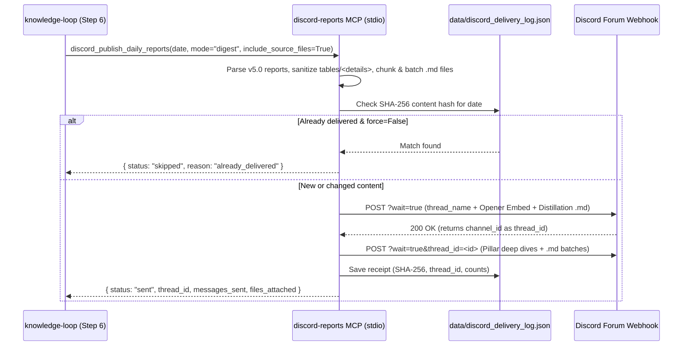

# Discord & MCP Setup Guide for `knowledge-loop`

This guide walks you through setting up Discord (a Forum channel + Webhook) and connecting the local `discord-reports` MCP server so `knowledge-loop` (via `deliver-discord-reports`) can automatically publish your Daily Knowledge Distillation and source `.md` reports to Discord.

---

## 1. Overview & Architecture

Every time `knowledge-loop` finishes distilling today's reports (Step 5), **Step 6 (`deliver-discord-reports`)** calls the local `discord-reports` MCP server to publish a clean, readable digest into Discord:

1. **Opener Forum Post (`📰 Daily Digest — YYYY-MM-DD`)**: Contains the v5.0 Answer-First Distillation Embed (`🎯 今日一句話結論`, `⚡ 本週唯一行動`, `💡 今日核心重點`, `📊 跨來源主題速覽`), a clickable Processed Reports Index, and the attached `Knowledge_Distillation_YYYY_MM_DD.md` file.
2. **In-Thread Deep Dives**: Cleaned pillar breakdowns (`<details>` tags and GFM tables converted for Discord readability), automatically chunked within Discord's 2,000-character limit.
3. **In-Thread `.md` Archive**: Each report's `.md` file is sanitized in memory before upload (stripping HTML `<details>/<summary>/<b>` tags and flattening tables so Discord's inline file preview reads cleanly, while keeping your local repo `.md` files untouched).



---

## 2. Prerequisites

- **Discord**: A Discord server where you have **Manage Server** (to enable Community / Forum channels) and **Manage Webhooks** permissions.
- **Python**: `Python 3.10+`
- **`uv`**: Installed locally (verify with `which uv` and `uv --version`).
- **MCP Client**: Antigravity IDE / CLI (or Claude Desktop / Cursor).

---

## 3. Part 1 — Setting Up Discord (Forum Channel + Webhook)

Using a **Discord Forum channel** is strongly recommended because each day's digest becomes one clean, collapsible post/thread (`📰 Daily Digest — YYYY-MM-DD`) instead of flooding a flat chat stream.

### Step 1.1: Create a Server & Enable Community (Required for Forum Channels)
> [!NOTE]
> Discord only shows the **Forum** channel type on servers with **Community** enabled. If you only want a standard flat Text channel, skip Step 1.1 and set `DISCORD_CHANNEL_TYPE="text"` in Part 3.

1. Open Discord and click **+** in the left server rail → **Create My Own** → **For me and my friends** (e.g., name it `AI Knowledge Hub`).
2. Open **Server Settings** (click the server name at top-left → **Server Settings**).
3. In the left sidebar under **Community**, click **Enable Community** → **Get Started**.
4. Complete the quick wizard (verification level + explicit media filter + rules/updates channels — Discord can auto-create them for you).

### Step 1.2: Create the Forum Channel
1. On your server's channel list, click **+** (**Create Channel**).
2. Select **Forum** as the **Channel Type**.
3. Name the channel (e.g., `daily-ai-digest`) and make it **Private Channel** if it is for personal reading only.
4. Click **Create Channel**.

### Step 1.3: Create & Copy the Channel Webhook URL
1. Hover over `#daily-ai-digest` and click the **Gear icon** (**Edit Channel**).
2. Go to **Integrations** → **Webhooks** → **Create Webhook** (or **New Webhook**).
3. Give it a name (e.g., `Daily AI Digest`) and optionally set an avatar.
4. Click **Copy Webhook URL**. It looks like:
   ```text
   https://discord.com/api/webhooks/<WEBHOOK_ID>/<WEBHOOK_TOKEN>
   ```

> [!CAUTION]
> **Treat your Webhook URL like a password.** Anyone with this URL can post to your channel.
> - **Never** commit `DISCORD_WEBHOOK_URL` into git, `AGENTS.md`, reports, or prompts.
> - Only store it in your local MCP client config (`~/.gemini/config/mcp_config.json`) under `"env"`.
> - If a URL is ever exposed, immediately open **Channel Settings → Integrations → Webhooks** and delete the compromised webhook.

---

## 4. Part 2 — Preparing the Local MCP Server

From your repository root (`<REPO_ROOT>`):

1. **Pre-warm Python dependencies (`mcp` and `httpx`)**:
   ```bash
   uv sync --directory mcp_servers/discord_reports
   ```
   This creates an isolated virtual environment inside `mcp_servers/discord_reports/.venv/` (ignored by `.gitignore`) so Antigravity launches the MCP server instantly with zero network delay.

2. **Run the offline test suite** to confirm everything in your clone works cleanly:
   ```bash
   pytest -p no:recording tests/test_discord_reports.py
   ```

---

## 5. Part 3 — Configuring MCP in Antigravity

Open (or create) your global Antigravity MCP configuration file:
`~/.gemini/config/mcp_config.json`

### Step 5.1: Find Your Absolute `uv` Path
macOS GUI applications often do not inherit `~/.local/bin` in `PATH`. Run:
```bash
which uv
```
Use that exact path (e.g., `/path/to/.local/bin/uv`) as `"command"`, or `"uv"` if it is on your system PATH. Replace `<KNOWLEDGE_LOOP_ROOT>` with the path to your `knowledge-loop` clone and `<DATA_REPO_ROOT>` with the path to your private Data Repo.

### Step 5.2: Add `discord-reports` to `mcp_config.json`

```json
{
  "mcpServers": {
    "discord-reports": {
      "command": "/path/to/.local/bin/uv",
      "args": [
        "run",
        "--directory",
        "<KNOWLEDGE_LOOP_ROOT>/mcp_servers/discord_reports",
        "python",
        "server.py"
      ],
      "env": {
        "KNOWLEDGE_LOOP_DATA_REPO": "<DATA_REPO_ROOT>",
        "DISCORD_WEBHOOK_URL": "https://discord.com/api/webhooks/YOUR_ID/YOUR_TOKEN",
        "DISCORD_CHANNEL_TYPE": "forum",
        "DISCORD_DEFAULT_MODE": "per_report",
        "DISCORD_USERNAME": "Daily AI Digest"
      }
    }
  }
}
```

> [!TIP]
> **Using Claude Desktop or Cursor?** The exact same `"discord-reports"` JSON block works inside `claude_desktop_config.json` or `.cursor/mcp.json`.

### Step 5.3: Environment Variables Reference

| Variable | Required | Default | Allowed Values | Behavior |
|---|---|---|---|---|
| `DISCORD_WEBHOOK_URL` | **Yes** (live sends) | `""` | Discord Webhook URL | Destination channel webhook. Missing URL returns structured error (never blocks `dry_run=True`). |
| `DISCORD_CHANNEL_TYPE` | No | `forum` | `forum`, `text` | `forum` opens 1 thread per day via `thread_name` + `?wait=true`; `text` posts flat messages directly to channel. |
| `DISCORD_DEFAULT_MODE` | No | `per_report` | `per_report`, `digest`, `distillation_only`, `full` | Default mode used when `discord_publish_daily_reports` is called without an explicit `mode`. |
| `DISCORD_USERNAME` | No | `Daily AI Digest` | Any string | Display name shown on Discord webhook messages. |

### Step 5.4: Verify Registration in Antigravity
1. In the Antigravity UI, open **Skills & Customizations → Installed MCP Servers** (or **Additional Options (`...`) → MCP Servers**) and click **Refresh**.
2. Start a **New Conversation** (existing conversations keep their initial MCP tool list until a new chat is opened).
3. Confirm **`discord-reports`** shows as connected and lists **3 tools**:
   - `discord_publish_daily_reports`
   - `discord_send_report_file`
   - `discord_delivery_status`

---

## 6. Part 4 — Usage & Verification Walkthrough

### Step 1: Safe Preview (`dry_run=True`)
Ask the agent:
> *"Run a dry-run Discord delivery for today's reports."*

The agent invokes `discord_publish_daily_reports(dry_run=True)` and returns a `payload_preview` without making HTTP calls or writing to `data/discord_delivery_log.json`.

### Step 2: First Live Send to Discord
Ask the agent:
> *"Send today's reports to Discord."*

Check your Discord `#daily-ai-digest` Forum channel:
- A new post titled `📰 Daily Digest — YYYY-MM-DD` appears.
- The opener message displays the **Answer-First Embed** (`🎯 今日一句話結論`, `⚡ 本週唯一行動`, `💡 今日核心重點`, `📊 跨來源主題速覽`, `📚 Processed Reports`) with `Knowledge_Distillation_YYYY_MM_DD.md` attached.
- Inside the thread, follow-up replies contain the cleaned pillar deep dives (`### ...`) and all daily individual `.md` report files (batched ≤10 files per message).

### Step 3: Verify Idempotency (Duplicate Protection)
Run *"Send today's reports to Discord"* a second time on the same day. Because the SHA-256 hash in `data/discord_delivery_log.json` matches, it immediately returns:
```json
{
  "status": "skipped",
  "reason": "already_delivered",
  "date": "2026-11-25",
  "thread_id": "1234567890123456789",
  "messages_sent": 0,
  "files_attached": 0
}
```
If you intentionally updated today's reports or want to post again anyway, either new file contents trigger an automatic resend, or pass `force=True` (*"Force resend today's reports to Discord"*).

### Step 4: Send a Single Report Ad-Hoc
Ask the agent:
> *"Send `reports/Website_2026_11_25/addyosmani.com_software_factories_light_and_dark.md` to Discord."*

This calls `discord_send_report_file(...)` and validates that the path resides strictly inside `reports/`.

### Step 5: Automatic Execution in `knowledge-loop`
When you run `"run my daily workflow"`, **Step 6 (`deliver-discord-reports`)** runs automatically right after `daily-distiller` (Step 5) and before interactive `review-suggestions` (Step 7). It is **fail-soft**: if Discord is unreachable or unconfigured, `knowledge-loop` logs the warning in Step 8 Final Summary and continues normally.

### Delivery Modes Comparison

| Mode | Forum Posts Created | Distillation Embed + `.md` | Individual Report Rendering | Individual `.md` Files (`include_source_files=True`) |
|---|---|---|---|---|
| **`per_report`** *(Default)* | 1 per source report + 1 top Daily Digest post | Pure native Discord Markdown (`# / ## / ### / -#`, full-width dark-mode PNGs for `📊` tables & `🔄` Mermaid diagrams, zero Embed boxes, posted last at top) | Full-width native Discord Markdown (`🎯` + `⭐ (N/5)` + `💡` + dark-mode PNG `📊` table + dark-mode PNG `🔄` Mermaid flowchart + chunked `🔍 深入解構`) | Optional (`include_source_files=False` by default; `overview_table.png` & `diagram_N.png` attached inline) |
| **`digest`** | 1 daily thread | Yes | 1-line index in opener Embed | Yes (batched ≤10 files/msg in thread) |
| **`distillation_only`** | 1 daily thread | Yes | No | No |
| **`full`** | 1 daily thread | Yes | Summary Embed cards inside the single daily thread | Yes (batched ≤10 files/msg in thread) |

---

## 7. Part 5 — MCP Tool API Reference

### `discord_publish_daily_reports`
Publishes all discovered reports for a date (`reports/distillations/` + `Newsletter_`, `Threads_`, `Website_`, `YouTube_`).
- **Parameters**:
  - `date` (`str | null`, default today): Target date in `YYYY-MM-DD`.
  - `mode` (`str | null`, default `DISCORD_DEFAULT_MODE` / `"digest"`): `"digest" | "distillation_only" | "full"`.
  - `include_source_files` (`bool`, default `true`): Attach all individual `.md` reports in ≤10-file batches.
  - `force` (`bool`, default `false`): Bypass SHA-256 idempotency check.
  - `dry_run` (`bool`, default `false`): Build and validate payloads without HTTP requests or ledger writes.
- **Sample Success Response**:
  ```json
  {
    "status": "sent",
    "date": "2026-11-25",
    "mode": "digest",
    "channel_type": "forum",
    "thread_id": "1310482910384726100",
    "messages_sent": 5,
    "files_attached": 28
  }
  ```

### `discord_send_report_file`
Publishes a single `.md` report inside `reports/`.
- **Parameters**:
  - `report_path` (`str`, required): Workspace-relative path under `reports/`.
  - `thread_id` (`str | null`, default `null`): Existing Forum thread ID to reply inside; omit to open a new thread.
  - `attach_markdown` (`bool`, default `true`): Attach the `.md` file.
  - `dry_run` (`bool`, default `false`): Preview without posting.

### `discord_delivery_status`
Reads `data/discord_delivery_log.json` without exposing webhook credentials.
- **Parameters**:
  - `date` (`str | null`, default `null`): Filter for one `YYYY-MM-DD` date, or omit to return all entries.

---

## 8. Part 6 — Troubleshooting & FAQ

| Symptom / Error | Likely Cause | Fix |
|---|---|---|
| `DISCORD_WEBHOOK_URL is not configured` | Env var missing or typo in `mcp_config.json` | Add `DISCORD_WEBHOOK_URL` under `env` in `~/.gemini/config/mcp_config.json` and restart Antigravity. |
| `HTTP 400 ... Check DISCORD_CHANNEL_TYPE` | Webhook points to a Text channel while `DISCORD_CHANNEL_TYPE="forum"` (or vice versa) | Either recreate the webhook on a **Forum** channel, or set `"DISCORD_CHANNEL_TYPE": "text"`. |
| MCP server fails to start (`spawn uv ENOENT`) | GUI app cannot find `uv` on default `PATH` | Run `which uv` in terminal and put the full path in `"command"` inside `mcp_config.json`. |
| `The 'mcp' package is required...` | Launched with system Python instead of `uv run` | Ensure `mcp_config.json` uses `"command": ".../uv"` with `args: ["run", "--directory", "...", "python", "server.py"]`, and run `uv sync --directory mcp_servers/discord_reports`. |
| `status: "skipped"` when expecting a resend | Same report contents already delivered today | Normal idempotency protection. Pass `force=True` or edit a report before resending. |
| `Invalid report_path: must reside within reports/` | Path points outside `<repo_root>/reports/` or is not `.md` | Pass a valid `.md` path under `reports/...`. |
| `Discord rate limit (429) persisted after 3 retries` | Sending very large bursts back-to-back | Wait ~30 seconds and retry; the server automatically honors `Retry-After` up to 3 attempts. |
| Need to rotate a leaked Webhook URL | Webhook URL was accidentally pasted in chat/logs | Delete the webhook in Discord **Channel Settings → Integrations → Webhooks**, create a new one, and update `mcp_config.json`. |
