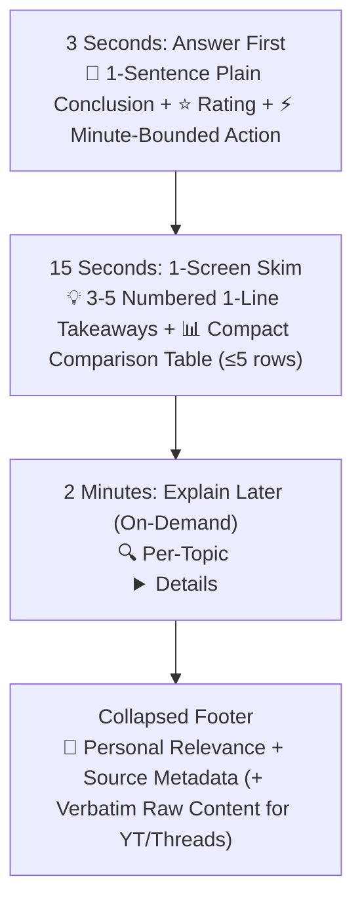

# RFC: Content Summary v5.0 — Answer-First Pyramid & Low-Cognitive-Load Hierarchy

## 1. Summary

Reorganize `content-summary` (v5.0), `daily-distiller` (v2.0), `ingest-website` (v1.3), and all worker sub-agent personas around the **Answer First, Explain Later (Pyramid / BLUF)** principle and **ADHD-friendly working-memory limits** (`ayghri/i-have-adhd`). Every report now opens on line 1 with a 1-sentence plain-language conclusion (`🎯 一句話結論`) and a concrete minute-bounded next action, keeps the visible top screen under ~25 scannable lines (`3–5 numbered takeaways` + `1 compact comparison table`), and places module/argument explanations, formulas, and benchmarks inside modular per-topic `
` accordions (`≤3 short bullets` per accordion) with Just-in-Time inline analogies.

## 2. Status

- **Current Status**: Approved
- **Proposal Date**: 2026-11-24
- **Last Updated**: 2026-11-24

**Affects**:
- [content-summary](../../.agents/skills/content-summary/SKILL.md) (`output_template.md`, `summarise.md`, `README.md`)
- [ingest-website](../../.agents/skills/ingest-website/SKILL.md) (`SKILL.md`, `README.md`)
- [daily-distiller](../../.agents/skills/daily-distiller/SKILL.md) (`SKILL.md`, `assets/output_template.md`, `README.md`)
- Sub-agent personas in `.agents/agents/` and synced `.claude/` + `.codex/` targets
- [test_output_template.py](../../tests/test_output_template.py)

## 3. Motivation

Evaluating real reports—including [xavierforge.dev_stanford_cme_295_lecture_5_llm_systems.md](../../reports/Website_2026_11_09/xavierforge.dev_stanford_cme_295_lecture_5_llm_systems.md), [The_Code_How_to_pick_a_decision_model.md](../../reports/Newsletter_2026_11_23/The_Code_How_to_pick_a_decision_model.md), [Brief_AI_電子報_Lean_社群認證黎曼猜想證明.md](../../reports/Newsletter_2026_11_23/Brief_AI_%E9%9B%BB%E5%AD%90%E5%A0%B1_Lean_%E7%A4%BE%E7%BE%A4%E8%AA%8D%E8%AD%89%E9%BB%8E%E6%9B%BC%E7%8C%9C%E6%83%B3%E8%AD%89%E6%98%8E.md), and [aiposthub_Google_Labs_Stitch_Loop_Autonomous_Product_Agent.md](../../reports/Threads_2026_11_20/aiposthub_Google_Labs_Stitch_Loop_Autonomous_Product_Agent.md)—alongside working-memory constraints highlighted by `ayghri/i-have-adhd` exposed four root causes of cognitive overload:

1. **Buried Bottom Line & Triple-Stacked Summaries**: Readers had to scroll past two metadata blocks, `Reading Decision`, `TL;DR`, `What Can I Learn`, and `Core Thesis`—reading the same summary three times before seeing how anything worked.
2. **Front-Loaded Memory Tax ("Keep X in Mind")**: Even a dedicated Pre-Context glossary at the top still forced the reader to memorize unfamiliar hardware/math terms upfront and hold them in working memory 60 lines later.
3. **Paragraph Walls Instead of Tables & Accordions**: Multi-option comparisons (`ZeRO / TP / PP / CP / EP`) were written as 200-character bullets instead of 5-row tables, and displaying 100+ lines uncollapsed exhausted visual attention.
4. **Forced Single-Thesis Run-On Sentences**: Multi-story digests and 5-part survey lectures were squeezed into 150-character single-sentence theses.

---

## 4. Detailed Design

### 4.1 Architecture & Inverted Pyramid Reading Horizons

### 4.2 Core Rules

1. **Answer First on Line 1**: Immediately below `# {title}`, render `> **🎯 一句話結論**` (≤45 chars, plain language, zero raw math) + `⭐ 推薦度 · 🔗 原文 · ⚡ 下一步` (with explicit minutes or `"純觀念吸收，無需待辦"`).
2. **Single Merged Takeaway List (`💡 核心重點`)**: 3–5 numbered 1-line takeaways (`≤45 chars` each), retiring separate overlapping `TL;DR` + `What Can I Learn` prose blocks.
3. **Tables Over Prose (`📊 一張表看懂`)**: Whenever ≥2 concepts/mechanisms are compared, summarize them in 1 compact table (`≤5 rows`, `≤18 chars/cell`) plus an optional ≤6-node `LR` Mermaid diagram for `★★★★☆+` systems flows. Omit on single-point/short posts.
4. **Per-Topic `
` Accordions (`🔍 深入解構`)**: Up to 5 individual `
` blocks (adapted to System Modules, Argument Steps, or Digest Stories). Each `
` states `N. Topic — 1-line conclusion`, and opening any single accordion reveals **only 2–3 short bullets** (`為什麼卡住 / 怎麼解決 / 數據與代價`) holding exact formulas, benchmarks, and **Just-in-Time inline analogies** (`≤10–12 chars` right where a term first appears).
5. **Aligned `daily-distiller` Pyramid**: `Knowledge_Distillation_YYYY_MM_DD.md` mirrors the exact same hierarchy (`🎯 今日一句話結論` + `⚡ 本週唯一行動` → `💡 今日核心重點` → `📊 跨來源主題速覽` table → per-pillar `
` accordions).

### 4.3 File & Module Changes

- **[MODIFY]** `.agents/skills/content-summary/{SKILL.md,README.md,references/output_template.md,references/summarise.md}` — Implement v5.0 Answer-First Pyramid, Just-in-Time Zone A+ inline analogies, ≤5 item working-memory cap, and per-topic `
` accordions.
- **[MODIFY]** `.agents/skills/ingest-website/{SKILL.md,README.md}` — Place Website domain/date inside the collapsed footer `
` so line 1 starts with the conclusion.
- **[MODIFY]** `.agents/skills/daily-distiller/{SKILL.md,README.md,assets/output_template.md}` — Upgrade Daily Distillation to the Answer-First Pyramid with per-pillar `
` accordions.
- **[MODIFY]** `.agents/agents/{website_worker,newsletter_worker,threads_worker,youtube_worker,distiller_reviewer}.md` — Align all sub-agent personas and sync across `.claude/` and `.codex/`.
- **[MODIFY]** `tests/test_output_template.py` — Verify Inverted Pyramid ordering, GFM `
` blank-line formatting, Just-in-Time context rules, ≤5 item cap, and `daily-distiller` template structure.

---

## 5. Drawbacks & Risks

- **GFM `
` Markdown Parsing**: Missing blank lines around `
` breaks Markdown/KaTeX rendering inside `
`. *Mitigation*: Enforce explicit blank lines in `output_template.md`, `summarise.md`, and `tests/test_output_template.py`.
- **Installing Upstream `ayghri/i-have-adhd` Verbatim**: Directly applying `i-have-adhd` was evaluated and rejected for report generation because 7 of its 10 rules target interactive coding chat (`"Step 3 of 5 done"`, CLI error logs) rather than static knowledge synthesis. Adapting its underlying working-memory principles (`≤5 cap`, action/time specificity, zero preamble, no off-screen memory tax) achieves full cognitive-load reduction tailored to reading reports.

---

## 6. Alternatives Considered

- **Option A: Keep traditional v4.6/v5.0 multi-heading linear prose with an upfront Pre-Context glossary**
  - *Rationale for Rejection*: Still forces scrolling past multiple summary layers and asks the reader to memorize an upfront glossary before reaching later sections.
- **Option B: One giant `
` block wrapping the entire deep dive**
  - *Rationale for Rejection*: Clicking expand still dumps 60+ lines onto the screen at once; per-topic accordions open only 5–6 lines for the exact sub-topic the reader wants.

---

# ADR: Answer-First Pyramid & Per-Topic Collapsible Accordions (v5.0)

## Context

Readers scanning daily technical summaries suffer working-memory fatigue when conclusions are buried beneath metadata, multiple overlapping summary sections, paragraph-length bullets, and front-loaded glossaries.

## Decision Drivers

- Instant 3-second comprehension of the 1-sentence conclusion and concrete next action
- Minimal visible working set (`≤5 items`, `~25 lines` on Screen 1, tables over prose)
- Zero off-screen memory tax via Just-in-Time inline analogies (`≤10–12 chars`)
- Full preservation of exact mathematical formulas and benchmarks on click

## Decisions Made

Adopt the **v5.0 Answer-First Pyramid** across `content-summary` and `daily-distiller`: lead on line 1 with `🎯 一句話結論` + `⚡ 下一步`, merge `TL;DR` + `What Can I Learn` into 3–5 numbered 1-line `💡 核心重點`, summarize multi-item comparisons in `📊 一張表看懂`, and isolate deep derivations into ≤5 per-topic `
` accordions (`≤3 short bullets` each).

## Consequences

- **Positive**: Reading load drops from ~120 uncollapsed lines of dense prose to a ~25-line scannable pyramid where every click expands at most 3 short bullets.
- **Negative**: Historical reports in `reports/` retain earlier layouts under the forward-only migration policy.
