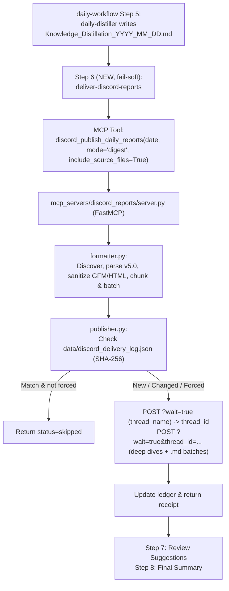

# RFC: Daily Workflow Discord Report Delivery (MCP Survey, PRD & Acceptance Criteria)

## 1. Summary
This RFC/PRD evaluates existing Discord Model Context Protocol (MCP) solutions and defines the exact specification and Acceptance Criteria (AC) to automatically deliver `daily-workflow` reports (Daily Knowledge Distillation and all daily source `.md` reports) to a Discord Forum channel. Because no official or open-source Discord MCP satisfies all four confirmed requirements together (**Webhook-only + Forum daily thread + Rich Embeds + local `.md` multi-file attachments**), this specification builds a lightweight local Python MCP server (`mcp_servers/discord_reports/`) and integrates it as an automatic fail-soft Step 6 in `daily-workflow`.

## 2. Status
- **Current Status**: Approved — Ready for `/goal` Execution
- **Proposal Date**: 2026-11-25
- **Last Updated**: 2026-11-25

### Confirmed Product Decisions
- **MCP Architecture**: Custom local Python Webhook MCP (`discord-reports`) — push-only Markdown report delivery, no two-way Discord chat required.
- **Target Channel Type**: Discord **Forum channel** (`DISCORD_CHANNEL_TYPE=forum`, default) — 1 clean daily post/thread per day via Webhook `thread_name` + `?wait=true` → `thread_id` (with graceful flat-channel fallback for `DISCORD_CHANNEL_TYPE=text`).
- **Default Payload**: `mode="per_report"` with **`include_source_files=True`** (1 dedicated Forum post per individual source report with full rendered Answer-First Embed + cleaned `🔍 深入解構` replies + `.md` attached, followed last by the `📰 Daily Digest — YYYY-MM-DD` Forum post so it sits at the top of the Forum channel; also supports `digest`, `distillation_only`, and `full`).
- **Workflow Integration**: Automatic **fail-soft Step 6** in `daily-workflow` (after Step 5 `daily-distiller`, before interactive `review-suggestions`), plus standalone `deliver-discord-reports` skill for ad-hoc sends.

## 3. Motivation
- **User Problem**: `daily-workflow` produces daily knowledge distillations (`reports/distillations/Knowledge_Distillation_YYYY_MM_DD.md`) and per-source reports (`reports/<Type>_YYYY_MM_DD/*.md`), but reading them currently requires opening the local repository. Delivering structured daily threads + verbatim `.md` attachments to Discord enables mobile/desktop reading and searchable archiving.
- **Format & Discord API Constraints**: Reports follow Content Summary v5.0 (Answer-First Pyramid, GFM tables, `
` accordions, `mermaid` blocks, relative links) and run **2,500–8,300+ chars** per distillation plus **4.5–8.8 KB × 3–15 source reports/day**. Discord enforces strict hard limits:
  - Message `content`: **2,000 chars** max
  - Embed `title`: **256 chars**; `description`: **4,096 chars**; `field.name`: **256 chars**; `field.value`: **1,024 chars**; `footer.text`: **2,048 chars**; **25 fields** max per embed; **10 embeds** max and **6,000 total chars** across all embeds per message
  - Forum `thread_name`: **100 chars** max
  - File attachments: **10 files / 10 MB** max per message (`multipart/form-data`)
  - No native rendering for HTML `
`, GFM Markdown tables, `mermaid`, or local relative links.

---

## 4. MCP Ecosystem Survey

### 4.1 Marketplace & Official Availability
- **Antigravity Marketplace**: No official or partner Discord plugin exists.
- **Official MCP Servers**: Neither Discord nor Anthropic publishes an official Discord MCP server.

### 4.2 Open-Source MCP Gap Matrix

| Open-Source MCP | Auth | Forum Threads (`thread_name` / reply) | Rich Embeds | Local `.md` File Attachments | Chunking & v5.0 Cleanup | Gap Summary |
|---|---|---|---|---|---|---|
| **`@kongyo2/discord-webhook-mcp`** (`kongyo2/discord-mcp`) | Webhook | No | Yes | No | No | No Forum `thread_name`/`thread_id`, no file uploads |
| **`thesammykins/notifyme_mcp`** | Webhook | No | Yes | No | No | No Forum threads, no file uploads |
| **`@kujirahand/discord-webhook-mcp`** | Webhook | No | No | Images only (`send_image`) | No | No `.md` files, no embeds, no Forum threads |
| **`@genpm/mcp-server-discord-webhook`** | Webhook | No | No | No | No | Plain text only |
| **`IQAIcom/mcp-discord`** / **`barryyip0625/mcp-discord`** | Bot Token + Intents | Yes | Partial | No (text/webhook focus) | No | Requires Bot App/Intents; no local `.md` batching or chunking |
| **`ExilProductions/discord-mcp`** / **`OrygnsCode/discord-mcp`** | Bot Token + Intents | Yes | Yes | Mostly URL/link-based | No | Requires Bot App/Intents; 30–160+ tools; no `.md` pipeline |
| **`SaseQ/discord-mcp`** (Java / Docker) | Bot Token + Intents | Yes | Yes | Inbound metadata focus | No | Heavy JVM/Docker footprint + Bot setup; no `.md` upload pipeline |
| **Custom Local Python MCP (`discord-reports`) [Chosen]** | **Webhook URL** | **Yes** | **Yes** | **Yes (batched ≤10)** | **Yes** | **Satisfies all 4 requirements in ~300 LOC with 3 lean tools** |

---

## 5. Acceptance Criteria (AC)

Every acceptance criterion below is **mandatory** for feature completion and must be verified by automated tests or skill validators unless explicitly marked manual.

### 5.1 Report Discovery & Content Parsing (`formatter.py`)
- **AC-1 (Daily Report Discovery)**:
  - Given a date `YYYY-MM-DD`, discover `reports/distillations/Knowledge_Distillation_YYYY_MM_DD.md` and all `.md` files in `reports/Newsletter_YYYY_MM_DD/`, `reports/Threads_YYYY_MM_DD/`, `reports/Website_YYYY_MM_DD/`, and `reports/YouTube_YYYY_MM_DD/` sorted deterministically by category then filename.
  - If neither the distillation nor any daily source report exists for `date`, return structured `{ "status": "no_reports", "date": "<date>", "messages_sent": 0, "files_attached": 0 }` without making any HTTP calls.
  - If source reports exist without a distillation file, still publish a valid fallback index Embed + source `.md` attachments (do not crash).
- **AC-2 (Content Summary v5.0 & Legacy Extraction)**:
  - Parse v5.0 distillations extracting: `# Title`, `🎯 今日一句話結論`, `⚡ 本週唯一行動`, `## 💡 今日核心重點`, `## 📊 跨來源主題速覽` (GFM table), and each `
` accordion under `## 🔍 主題深入解構` (excluding the `📚 今日合成來源清單` footer accordion from deep-dive prose).
  - Parse v5.0 individual source reports extracting: `# Title`, `🎯 一句話結論`, `⭐ 推薦度`, and external `🔗 來源` URL (`http://` or `https://`).
  - Gracefully fall back on pre-v5 legacy distillations (e.g., `## 📝 Executive Summary` / `## 🏗️` sections without `
`) by extracting title, executive summary, and body sections without raising errors.
- **AC-3 (Discord-Safe Markdown Sanitization)**:
  - Convert GFM tables (`| col | col |`) into compact readable bullet lines (`• **Col1** — Col2 → Col3 (Col4)`), leaving zero raw pipe-separator rows (`|---|---|`).
  - Strip all `
`, `
`, `
`, `
`, `<b>`, `</b>` HTML tags, turning `
` titles into bold Markdown headings (`### ...`).
  - Strip or replace workspace-relative Markdown links (`[label](../Website_.../file.md)`) so zero broken relative links remain in Discord message text; preserve external `http(s)://` links.
  - Remove or summarize `mermaid` fenced code blocks in Embed descriptions so raw diagram syntax does not clutter the top summary card.

### 5.2 Discord API Limit & Payload Invariants (`formatter.py` + `publisher.py`)
- **AC-4 (Hard Character & Field Budgets)**:
  - Every outgoing message `content` MUST be `≤ 2,000` characters (chunk target `≤ 1,900` chars, splitting cleanly on paragraph/line boundaries without mid-word breaks when possible).
  - Every Embed MUST satisfy: `len(title) ≤ 256`, `len(description) ≤ 4,096`, `len(field.name) ≤ 256`, `len(field.value) ≤ 1,024`, `len(footer.text) ≤ 2,048`, `len(fields) ≤ 25`.
  - Every single HTTP request MUST satisfy: `len(embeds) ≤ 10` and total combined character count across all embeds in that request `≤ 6,000`.
  - Forum `thread_name` MUST be `≤ 100` characters (truncated cleanly with `…` if needed).
- **AC-5 (Multi-File `.md` Attachment Batching)**:
  - In default `digest` mode (`include_source_files=True`):
    - Attach `Knowledge_Distillation_YYYY_MM_DD.md` to the opener message (if it exists).
    - Attach all discovered individual `.md` reports in follow-up messages batched at **≤ 10 files per request** and **≤ 8 MB per batch** (safe margin below Discord's 10 MB free-tier cap), using `multipart/form-data` (`payload_json` + `files[0]..files[N]`).
  - When `include_source_files=False` or `mode="distillation_only"`, attach only `Knowledge_Distillation_YYYY_MM_DD.md` (zero individual `.md` attachments).
  - When `mode="full"`, post opener Distillation Embed + one concise Embed reply per source report inside the thread + batched `.md` attachments.

### 5.3 Discord Transport, Threading & Resilience (`publisher.py`)
- **AC-6 (Forum Channel Threading & Text Channel Fallback)**:
  - When `DISCORD_CHANNEL_TYPE=forum` (default):
    - Message 1 sends `POST <webhook_url>?wait=true` with `"thread_name": "📰 Daily Digest — YYYY-MM-DD"` (or date + short title, `≤ 100` chars).
    - Parse `channel_id` from the JSON response as `thread_id`.
    - All subsequent replies (pillar deep dives, report embeds, `.md` attachment batches) send `POST <webhook_url>?wait=true&thread_id=<thread_id>`.
  - When `DISCORD_CHANNEL_TYPE=text`:
    - Omit `thread_name` and `thread_id`; post opener Embed and follow-up messages sequentially to the channel.
  - On HTTP `400` mentioning forum/thread mismatch, return an actionable error message hinting to check `DISCORD_CHANNEL_TYPE`.
- **AC-7 (Rate-Limit Backoff & Error Handling)**:
  - On HTTP `429 Too Many Requests`, honor `Retry-After` (response header or JSON `retry_after` field) and retry up to 3 times before failing cleanly.
  - Never raise unhandled exceptions out of MCP tool handlers; always return structured JSON with `status: "error"` and a concise `error` string.
- **AC-8 (Idempotency Ledger)**:
  - Maintain local ledger at `data/discord_delivery_log.json` keyed by `<date>` storing `{ "date", "mode", "include_source_files", "content_sha256", "thread_id", "messages_sent", "files_attached", "delivered_at" }`.
  - Compute `content_sha256` deterministically from the sorted relative paths and file contents of the reports included for that date/mode.
  - On rerun with the same `date`, `mode`, `include_source_files`, and matching `content_sha256` when `force=False`: skip HTTP delivery and return `{ "status": "skipped", "reason": "already_delivered", "thread_id": "<existing>", "messages_sent": 0, "files_attached": 0 }`.
  - When report content changed OR `force=True`: re-deliver and update the ledger entry.
  - When `dry_run=True`: perform full discovery, parsing, formatting, and limit validation, return `{ "status": "dry_run", ... , "payload_preview": [...] }` with **zero HTTP calls** and **zero ledger writes**.

### 5.4 MCP Server Contract & Security (`server.py`)
- **AC-9 (Minimal 3-Tool MCP Interface)**:
  - Implement stdio `FastMCP` server in `mcp_servers/discord_reports/server.py` (runnable via `uv run --directory mcp_servers/discord_reports python server.py`) exposing exactly 3 tools:
    1. `discord_publish_daily_reports(date: str | None = None, mode: str | None = None, include_source_files: bool = True, force: bool = False, dry_run: bool = False)`
    2. `discord_send_report_file(report_path: str, thread_id: str | None = None, attach_markdown: bool = True, dry_run: bool = False)`
    3. `discord_delivery_status(date: str | None = None)`
  - Environment variables read inside the MCP server:
    - `DISCORD_WEBHOOK_URL` (required for non-`dry_run` sends; missing URL returns structured `{ "status": "error", "error": "DISCORD_WEBHOOK_URL is not configured" }`)
    - `DISCORD_CHANNEL_TYPE` (`forum` | `text`, default: `forum`)
    - `DISCORD_DEFAULT_MODE` (`digest` | `distillation_only` | `full`, default: `digest`)
    - `DISCORD_USERNAME` (optional, default: `Daily AI Digest`)
- **AC-10 (Security Invariants)**:
  - **Credential Redaction**: Every error message, log line, and tool response MUST scrub Discord webhook URLs/tokens (`https://discord.com/api/webhooks/<id>/***`) — the raw webhook token MUST NEVER appear in tool output or exceptions.
  - **Path Containment**: `discord_send_report_file` MUST resolve `report_path` against `<repo_root>` and reject any path outside `<repo_root>/reports/` (including `../` traversal and symlinks escaping `reports/`) with `{ "status": "error", "error": "Invalid report_path: must reside within reports/" }`.

### 5.5 Skills, Daily Workflow Integration & Repository Hygiene
- **AC-11 (Standalone Skill `deliver-discord-reports`)**:
  - Create `.agents/skills/deliver-discord-reports/SKILL.md` (Lean Spine `< 200` lines, valid YAML frontmatter, triggers for `"send today's reports to Discord"`, `"deliver reports to Discord"`, `"push daily digest to Discord"`) and `.agents/skills/deliver-discord-reports/README.md` containing setup guide (Discord Webhook + Antigravity MCP config JSON), ADRs, and Changelog.
  - Must pass `python3 scripts/validate_skill.py .agents/skills/deliver-discord-reports/SKILL.md` with exit code `0`.
- **AC-12 (`daily-workflow` Automatic Fail-Soft Step 6)**:
  - Update `.agents/skills/daily-workflow/SKILL.md` to insert **Step 6 — Deliver to Discord** immediately after Step 5 (`Distill Knowledge`), shifting `Review Suggestions` to Step 7 and `Final Summary` to Step 8.
  - Explicitly enforce **fail-soft** execution: if `discord-reports` MCP is unavailable/unconfigured or returns `status: "error"`, log the reason and continue to Step 7 and Step 8 without failing the workflow.
  - Update `.agents/skills/daily-workflow/references/dispatch_spec.md` Final Summary schema to include:
    `Discord delivery: ✅ Sent (<mode>, thread <thread_id>, <N> files) | ⏭️ Skipped (already sent) | ⚠️ FAILED (<reason>)`
  - Update `.agents/skills/daily-workflow/README.md` with ADR + Changelog entry.
  - Must pass `python3 scripts/validate_skill.py .agents/skills/daily-workflow/SKILL.md` with exit code `0`.
- **AC-13 (Repository Hygiene & Automated Regression Gate)**:
  - Update `.gitignore` to ignore `data/discord_delivery_log.json` and `mcp_servers/discord_reports/.venv/`.
  - All unit tests in `tests/test_discord_reports.py` covering AC-1 through AC-10 pass offline via `pytest -p no:recording tests/test_discord_reports.py` (exit code `0`, zero live network calls).
  - Full repository regression suite `pytest -p no:recording --ignore=tests/test_compile_session_learnings.py` passes (exit code `0`).

---

## 6. Architecture & File Changes

### 6.1 End-to-End Flow

### 6.2 File & Module Changes
- **[NEW]** `mcp_servers/discord_reports/pyproject.toml` — Python package (`mcp`, `httpx`), runnable via `uv run`.
- **[NEW]** `mcp_servers/discord_reports/formatter.py` — Deterministic discovery, v5.0/legacy parser, GFM/HTML sanitizer, Embed/chunk/attachment batch builder.
- **[NEW]** `mcp_servers/discord_reports/publisher.py` — `httpx` Webhook publisher (Forum + Text, multipart uploads, 429 backoff, token redaction) + SHA-256 `DeliveryLedger`.
- **[NEW]** `mcp_servers/discord_reports/server.py` — Thin `FastMCP` stdio server exposing the 3 tools + path containment guard.
- **[NEW]** `.agents/skills/deliver-discord-reports/SKILL.md` & `README.md` — Standalone skill, setup docs, ADRs, Changelog.
- **[MODIFY]** `.agents/skills/daily-workflow/SKILL.md`, `references/dispatch_spec.md`, & `README.md` — Fail-soft Step 6, Final Summary line, ADR & Changelog.
- **[MODIFY]** `.gitignore` — Ignore `data/discord_delivery_log.json` and `mcp_servers/discord_reports/.venv/`.
- **[NEW]** `tests/test_discord_reports.py` — Complete offline automated verification suite mapped 1:1 to AC-1..AC-10.

---

## 7. Drawbacks & Risks
- **Local Server Ownership (~300 LOC)**: Mitigated by minimal dependencies (`mcp`, `httpx`), pure-function formatter design, and 100% offline unit tests.
- **Push-Only Scope**: Webhook transport cannot read Discord replies or create threads in standard Text channels. Explicitly accepted per user decision (push-only `.md` report delivery to Forum channel).
- **First-Run `uv` Dependency Resolution**: First MCP startup downloads `mcp` into `uv` cache; mitigated by documenting a one-line pre-warm command (`uv sync --directory mcp_servers/discord_reports`) in `deliver-discord-reports/README.md`.

---

# ADR: Webhook-First Local Python MCP Server for Daily Report Delivery

## Context
No official or open-source Discord MCP combines Webhook-only auth, Forum channel `thread_name`/`thread_id` chaining, rich Embeds, batched local `.md` file uploads, and v5.0 Markdown sanitization.

## Decision Drivers
- Zero Bot/Intents setup and least-privilege channel-scoped Webhook credential.
- Deterministic compliance with Discord's 2,000 / 4,096 / 6,000-char and 10-file limits without LLM token waste.
- Clean mobile/desktop readability in a Discord Forum channel with verbatim `.md` archival attachments.
- Full offline automated verification via `pytest`.

## Decisions Made
1. Implement a 3-tool local Python `FastMCP` stdio server (`mcp_servers/discord_reports/`) using Discord Webhooks.
2. Default to `DISCORD_CHANNEL_TYPE=forum`, `mode="digest"`, and `include_source_files=True`.
3. Wire into `daily-workflow` as automatic fail-soft Step 6 with SHA-256 idempotency ledger (`data/discord_delivery_log.json`).

## Consequences
- **Positive**: 1-minute user setup (paste one Webhook URL), zero duplicate spam on reruns, zero broken `
`/tables in Discord, all `.md` reports archived in-thread.
- **Negative**: Push-only; ~300 LOC maintained locally.
