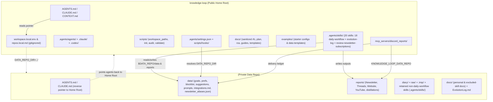

# RFC: Adopt Home Repo Pattern (`knowledge-loop` as Home Root, `<data-repo>` as Data Repo)

## 1. Summary

Adopt the [Home Repo Pattern](https://www.aihero.dev/the-home-repo-pattern) by decoupling agent infrastructure from personal data across two repositories: **`knowledge-loop`** (public **Home Root** owning all agent skills, personas, hooks, MCP servers, scripts, tests, design docs, guidelines, and starter configuration examples) and **`<data-repo>`** (private **Data Repo** owning personal goals, preferences, reports, diaries, private integration mappings, and personal logs). All skills, scripts, hooks, MCP servers, and documentation in `knowledge-loop` will be fully sanitized of PII and hardcoded absolute paths so any user can clone, configure, and run the system on any macOS machine.

## 2. Status

- **Current Status**: Proposed
- **Proposal Date**: 2026-11-26
- **Last Updated**: 2026-11-26
- **Implementation Plan**: [Home Repo Pattern Architecture Plan](../plan/home-repo-pattern-architecture-plan.md)
- **Supersedes**: Legacy one-way copy script (`scripts/sync_knowledge_loop.py`)

## 3. Motivation

### Current Pain Points
1. **Inverted Source of Truth & Sync Drift**: Previously, `<data-repo>` held both private personal data and shared agent skills, relying on `scripts/sync_knowledge_loop.py` to copy 13 skills to `knowledge-loop`. That missed newer `daily-workflow` dependencies (`deliver-discord-reports` and the 4 `gws-*`/`agent-browser` adapter skills), required manual copy runs, and never deleted stale files.
2. **Privacy & PII Coupling Inside Skills and Docs**:
   - Hardcoded absolute paths (`...`) appear across 30+ files (including 19 references in `rubric-grader` alone and ~90+ references across `docs/rca/`, `docs/plan/`, and `docs/rfc/`).
   - Personal Jira project keys and Epic IDs (`AW`, `PROJ-1`–`PROJ-7`) are embedded in `AGENTS.md` and `scripts/jira_migration/`.
   - Non-`daily-workflow` personal skills (such as `log-task-evidence`, `sync-diary`, `writing-style-technical-english`, `decision-sparring`, etc.) live in the same `.agents/skills/` tree as the core `daily-workflow` pipeline, tangling private Notion IDs and employer writing samples with the reusable content-intelligence pipeline.
   - Personal career logs (`docs/career_mock_interview_log.md`), historical personal backlogs (`docs/archive/backlog_historical.md`), and live-run audits (`docs/daily_workflow_deterministic_audit_2026-11-20.md`) live alongside reusable engineering RFCs.
3. **Single-Repo Path Assumption**: Hooks (`scripts/hooks/ensure_lang_preferences.sh`), validators (`scripts/validate_language_config.py`), and the local MCP server (`mcp_servers/discord_reports/server.py`) all assume `data/` and `reports/` live under the same repository root (`REPO_ROOT`), preventing clean separation between a public Home Root and a private Data Repo.
4. **No Turnkey Onboarding for Public Users**: External users cloning `knowledge-loop` lack configuration templates (`examples/`), a workspace bootstrap script, and automated checks proving the repository is portable on any Mac.

### Value Delivered
- **Single Source of Truth**: `knowledge-loop` becomes the authoritative Home Root for all agent capabilities, steering guidelines, and design documentation — eliminating one-way copy scripts and configuration drift.
- **Privacy by Architecture**: Private data, personal IDs, and generated reports never enter the public repository; automated CI/local hygiene tests block accidental PII or absolute-path leaks.
- **Zero-Absolute-Path macOS Portability**: Any user can clone `knowledge-loop`, run a bootstrap script (or copy examples), point it to their own private Data Repo (or run standalone), and use all workflows on any macOS machine.

---

## 4. Detailed Design

### 4.1 Architecture & Repository Boundary



### 4.2 Portable Data Repo Resolution Contract (`$DATA_REPO`)

To eliminate all hardcoded absolute paths while supporting AI agents, shell hooks, Python scripts, and stdio MCP servers uniformly:

1. **Gitignored Local Pointer Files (in `knowledge-loop`, never committed)**:
   - `workspace.local.env` (copied from `examples/workspace.local.env.example`): machine-parseable `KEY=VALUE` file for scripts, hooks, and MCP servers:
     ```bash
     # Relative to the knowledge-loop repository root, or ~/-prefixed path
     DATA_REPO_DIR="../<data-repo>"
     USER_TIMEZONE="Asia/Taipei"
     ```
   - `repos.local.md` (copied from `examples/repos.local.md.example`): Home Repo Pattern plain-text pointer map read by `AGENTS.md` so any coding agent (Antigravity, Claude Code, Codex, Cursor) can orient itself across the Data Repo and any additional user repositories.
   - `knowledge-loop.code-workspace` (optional, gitignored; copied from `examples/knowledge-loop.code-workspace.example`): multi-root workspace descriptor mounting `.` (Home Root) and `../<your-data-repo>` (Data Repo) side by side so macOS workspace sandboxes grant read/write access to both repositories natively without bypassing sandbox rules.

2. **Deterministic Resolution Precedence** (implemented in shared `scripts/lib/workspace_paths.py` and `scripts/lib/resolve_data_repo.sh`):
   1. Explicit CLI argument (`--data-repo <path>`) when provided.
   2. Environment variable `KNOWLEDGE_LOOP_DATA_REPO` (supports `~` expansion; relative paths resolve against `HOME_ROOT`).
   3. `DATA_REPO_DIR` from `<HOME_ROOT>/workspace.local.env` (if file exists).
   4. Single-repo fallback: `<HOME_ROOT>` itself if `<HOME_ROOT>/data/` exists (allows external users to try `knowledge-loop` standalone in single-repo mode without creating a second repo first).
   5. Fail-fast error with setup pointer (`scripts/init_workspace.sh` / `docs/guides/home-repo-setup-guide.md`) if none of the above resolve to an existing directory.

3. **Symbolic Path Convention in Skills & Personas**:
   - `AGENTS.md` defines `$DATA_REPO` as the resolved path from `repos.local.md` / `workspace.local.env` (defaulting to `.` in single-repo mode).
   - Every skill (`SKILL.md`, `references/*.md`) and sub-agent persona (`.agents/agents/*.md`) replaces repo-local `data/...`, `reports/...`, `diary/...` and hardcoded `file://<HOME_DIR>` links with `$DATA_REPO/data/...`, `$DATA_REPO/reports/...`, `$DATA_REPO/diary/...` and relative links for files inside `knowledge-loop`.

4. **MCP Server Path Resolution (`mcp_servers/discord_reports/server.py`)**:
   - Replace static `DEFAULT_REPO_ROOT = Path(__file__).resolve().parents[2]` with `resolve_data_repo()` using the exact same precedence (`KNOWLEDGE_LOOP_DATA_REPO` env var → `workspace.local.env` → fallback to repo root).
   - `examples/mcp_config.example.json` documents passing `KNOWLEDGE_LOOP_DATA_REPO` under `"env"` and using `which uv` on macOS (without hardcoding any username).

### 4.3 Asset Ownership Matrix

| Category | `knowledge-loop` (Public Home Root) | `<data-repo>` (Private Data Repo) |
| :--- | :--- | :--- |
| **Steering & Context** | `AGENTS.md` (generic, `$DATA_REPO`-aware), `CLAUDE.md`, `CONTEXT.md`, `README.md`, sanitized `known_issues.md` | Slim `AGENTS.md` & `CLAUDE.md` (reverse pointer to Home Root + data hygiene rules), local `known_issues.local.md` (optional) |
| **Agent Skills** | **20 skills** in `.agents/skills/`: the 18 `daily-workflow` pipeline skills + `evolution-log` + `review-newsletter-subscriptions` (16 custom + 4 external `gws-*`/`agent-browser`) + `skills-lock.json` | 9 excluded skills retained privately in `<data-repo>/.agents/skills/` (the 20 migrated skills removed here so Home Root is SSOT) |
| **Sub-Agent Personas** | `.agents/agents/*` (all 6 `daily-workflow` workers) + synced `.claude/{agents,subagents}/` + `.codex/{agents,subagents}/` | None |
| **Hooks & Scripts** | `.agents/settings.json`, `scripts/hooks/*`, `scripts/lib/*`, `scripts/validate_skill.py`, `scripts/validate_language_config.py`, `scripts/sync_subagents.py`, `scripts/init_workspace.sh`, `scripts/audit_public_repo.py` | Retired `scripts/sync_knowledge_loop.py`; `scripts/jira_migration/` archived privately (contains `PROJ-1..PROJ-90` personal migration logic) |
| **MCP Servers** | `mcp_servers/discord_reports/` (with `KNOWLEDGE_LOOP_DATA_REPO` resolution) | None (runtime ledger stays at `data/discord_delivery_log.json`) |
| **Design Docs & Guides** | `docs/templates/`, `docs/guides/` (incl. new `home-repo-setup-guide.md`), sanitized `daily-workflow` / `evolution-log` / `review-newsletter-subscriptions` `docs/{rfc,plan,rca}/`, `docs/cognitive_bandwidth_protection_guide.md`, `docs/loop_engineering_coverage_assessment.md` | Excluded-skill & personal RFCs/plans, `docs/career_mock_interview_log.md`, `docs/archive/backlog_historical.md`, `docs/decisions/`, `backlog.md`, `EvolutionLog.md` |
| **Configuration Examples** | `examples/` (`workspace.local.env.example`, `repos.local.md.example`, `knowledge-loop.code-workspace.example`, `mcp_config.example.json`, `examples/data/*` incl. `newsletter_aliases.example.json`) | N/A |
| **Personal Data & Outputs** | None (gitignored if single-repo trial mode is used) | `data/*` (incl. `data/integrations.md`, `data/newsletter_aliases.json`), `reports/*`, `diary/*`, `raw/*`, `.tmp/*` |
| **Tests & CI** | `tests/` (`test_discord_reports.py`, `test_newsletter_subscription_reviewer.py`, `test_output_template.py`, `test_suggestion_archetypes.py`, `test_suggestion_payload_schema.py`, + new `test_public_repo_hygiene.py` & `test_workspace_resolution.py`) + optional `.github/workflows/ci.yml` | Tests for retained private skills (`test_agent_rules_reviewer.py`, `test_sync_diary.py`, `test_jira_*.py`) |

### 4.4 Validated Skill Scope (20 Included / 9 Excluded)

Transitive dependency traversal starting from `daily-workflow` and its 6 worker personas (`newsletter_worker`, `threads_worker`, `website_worker`, `youtube_worker`, `rubric_grader`, `distiller_reviewer`) identifies **18 core pipeline skills**, plus **2 approved companion skills** (`evolution-log` and `review-newsletter-subscriptions`) for **20 total skills** in `knowledge-loop`:

#### Included in `knowledge-loop` (20 Skills = 16 Custom + 4 External)

| Layer | Skill | Direct Caller(s) / Role | Sanitization / Portability Action |
| :--- | :--- | :--- | :--- |
| **Orchestrator (1)** | `daily-workflow` | Entry point | Parameterize `data/` & `reports/` to `$DATA_REPO/...`; make Gmail label (`newsletter`) & Google Tasks list (`Delegate`) configurable via `$DATA_REPO/data/integrations.md` |
| **Ingestion (4)** | `ingest-newsletter` | `newsletter_worker` | Parameterize `reports/Newsletter_*` and suggestion staging paths to `$DATA_REPO/...` |
| | `ingest-threads` | `threads_worker` | Parameterize `reports/Threads_*` and suggestion staging paths to `$DATA_REPO/...` |
| | `ingest-website` | `website_worker` | Parameterize `reports/Website_*` and suggestion staging paths to `$DATA_REPO/...` |
| | `ingest-youtube` | `youtube_worker` | Parameterize `reports/YouTube_*` and suggestion staging paths to `$DATA_REPO/...` |
| **Core Loop (5)** | `content-summary` | All 4 `ingest-*` skills & 4 worker personas | Parameterize `data/lang_preferences.md`, `data/user_preferences.md`, `data/goals.md`, and `data/suggestions_pending/` to `$DATA_REPO/...` |
| | `rubric-grader` | `rubric_grader` persona, `daily-workflow` Step 4, `content-summary` | Replace all **19 hardcoded `...` paths** across `SKILL.md`, `README.md`, `references/rubric.md` with relative links + `$DATA_REPO/data/...` |
| | `daily-distiller` | `distiller_reviewer` persona, `daily-workflow` Step 5 | Parameterize `reports/`, `reports/distillations/`, and `data/lang_preferences.md` to `$DATA_REPO/...` |
| | `deliver-discord-reports` | `daily-workflow` Step 6 | Keep MCP-only fail-fast workflow; reference `docs/guides/discord-mcp-setup-guide.md` via relative link |
| | `review-suggestions` | `distiller_reviewer` persona, `daily-workflow` Step 7 | Parameterize `data/suggestions_*.md` and `data/user_preferences.md` to `$DATA_REPO/...` |
| **Extraction Helpers (4)** | `content-cleaner` | `ingest-website`, `web-to-markdown` | Parameterize default save path to `$DATA_REPO/reports/Articles_YYYY_MM_DD/` |
| | `fetch-threads-post` | `ingest-threads` | Verify `scripts/fetch-thread.sh` has zero hardcoded paths (already clean) |
| | `web-to-markdown` | `website_worker` persona | Parameterize default save path to `$DATA_REPO/reports/Articles_YYYY_MM_DD/` |
| | `yt2doc` | `ingest-youtube`, `youtube_worker`, `daily-workflow` | Parameterize default `--output` path to `$DATA_REPO/reports/YouTube_YYYY_MM_DD/` |
| **Companion Workflow Skills (2)** | `review-newsletter-subscriptions` | Periodic newsletter ROI & subscription triage | Update `scripts/analyze_subscriptions.py` to resolve `$DATA_REPO` via `workspace_paths.py` and load optional custom newsletter aliases from `$DATA_REPO/data/newsletter_aliases.json` (ship `examples/data/newsletter_aliases.example.json`) |
| | `evolution-log` | Project architecture & evolution chronicle | Verify zero personal paths in `SKILL.md`, `references/`, `evals/evals.json` (personal `EvolutionLog.md` stays in `<data-repo>`) |
| **External CLI Adapters (4)** | `agent-browser` | `daily-workflow`, `ingest-threads`, `fetch-threads-post`, `threads_worker`, `content-cleaner` | Include via `skills-lock.json`; verify zero personal paths |
| | `gws-gmail` | `ingest-newsletter`, `newsletter_worker` | Include via `skills-lock.json` |
| | `gws-shared` | `daily-workflow`, `ingest-newsletter`, `gws-gmail`, `gws-tasks`, `content-summary` | Include via `skills-lock.json` |
| | `gws-tasks` | `ingest-threads`, `ingest-website`, `ingest-youtube` | Include via `skills-lock.json` |

#### Excluded from `knowledge-loop` — Retained in `<data-repo>/.agents/skills/` (9 Skills)

- `agent-rules-reviewer`, `ai-level-check` *(empty stub)*, `decision-sparring`, `log-task-evidence`, `skill-context-refactor`, `study-github-repo`, `sync-diary`, `tech-deconstructor`, `writing-style-technical-english`.
- Excluding these keeps `knowledge-loop` focused on the content-intelligence loop and eliminates all private Notion IDs (`log-task-evidence`, `sync-diary`) and personal employer writing samples (`writing-style-technical-english`) from the public repository.

### 4.5 Automated Public Hygiene & Portability Gate (`scripts/audit_public_repo.py`)

A dedicated Python verification script (zero external dependencies) and pytest suite will enforce public-repo invariants on every change:
1. **Forbidden Absolute Paths**: Reject machine-specific home directories (macOS, Linux, Windows, and local `file://` URIs) across all tracked text files.
2. **Forbidden Personal Identifiers**: Reject personal usernames/handles (`<user>`), private repo name (`<data-repo>`), real employer/service identifiers (`PaymentService`, `OrderService`), and personal Jira keys (`AW-[0-9]+`).
3. **Forbidden Private IDs & Credentials**: Reject live Discord webhook URLs (`discord.com/api/webhooks/\d+/`), personal Notion UUID prefixes (`3cd60ab2`, `34260ab2`, `3a8f3775`), personal email addresses (outside standard RFC 2606 `@example.com` / `@test.com` placeholders), and secret token patterns (`sk-`, `ghp_`, `ntn_`, `ATATT`).
4. **Cross-Machine Isolation Test**: Execute `validate_skill.py`, `validate_language_config.py`, `ensure_lang_preferences.sh`, and `discord_reports` / `output_template` / `suggestion_*` unit tests using a temporary Data Repo at an arbitrary `tmp_path` directory (`KNOWLEDGE_LOOP_DATA_REPO=<tmp>/arbitrary-data-repo`) to prove zero dependence on directory name or machine user.

---

## 5. Drawbacks & Risks

1. **Multi-Root Sandbox Friction on macOS**:
   - *Risk*: When an agent session opens only `knowledge-loop`, macOS workspace sandboxes block writes to sibling `../<data-repo>`.
   - *Mitigation*: Provide `examples/knowledge-loop.code-workspace.example` (VS Code / Antigravity multi-root workspace) and `--add-dir` CLI instructions for Claude Code / Codex, plus a fallback single-repo mode for quick evaluation.
2. **Git History Exposure in Existing `knowledge-loop` Repo**:
   - *Risk*: If `knowledge-loop` already has prior commits copied by `scripts/sync_knowledge_loop.py`, older commits in Git history may still contain `~/...` paths or personal details from earlier RFCs/RCAs/skills.
   - *Mitigation*: Audit `knowledge-loop` git history before making/keeping it public; if sensitive data exists in old commits, perform a clean squash/history-rewrite or `git-filter-repo` pass (explicit user decision required).
3. **Broken Relative Links Across Split Repos**:
   - *Risk*: Docs moved to `knowledge-loop/docs/` may link to files that stayed in `<data-repo>` (e.g., `docs/archive/backlog_historical.md` or sample reports).
   - *Mitigation*: Add a broken-link check to `audit_public_repo.py` verifying every relative Markdown link inside `knowledge-loop` resolves inside `knowledge-loop`.
4. **Cutover Disruption to Live Daily Workflow**:
   - *Risk*: Moving skills and MCP servers out of `<data-repo>` requires updating `~/.gemini/config/mcp_config.json` and opening the new workspace; mid-migration errors could pause daily ingestion.
   - *Mitigation*: Execute in phases — keep `<data-repo>` untouched until `knowledge-loop` passes full shadow verification against `<data-repo>`, then perform a clean, single-commit cleanup of `<data-repo>`.
5. **Focused Skill Scope & Context Budget**:
   - *Risk*: Narrowing `knowledge-loop` strictly to the 18 `daily-workflow` pipeline skills leaves the 11 excluded personal/auxiliary skills needing a home on the author's machine.
   - *Mitigation*: Retain excluded personal skills in `<data-repo>/.agents/skills/` (or relocate general-purpose ones to global `~/.gemini/config/skills/`), keeping `knowledge-loop` laser-focused, lean, and 100% free of private Notion/writing-style couplings.

---

## 6. Alternatives Considered

- **Option A: Keep `scripts/sync_knowledge_loop.py` Copy Model (Status Quo)**
  - *Description*: Maintain `<data-repo>` as source of truth and copy selected files to `knowledge-loop` with a sanitizer script.
  - *Rationale for Rejection*: Perpetuates dual-maintenance drift, requires fragile automated text-rewriting regexes for sanitization, and contradicts the Home Repo Pattern where the central repo IS the Home Root.
- **Option B: Symlink Data Directories (`data/`, `reports/`, `diary/`) Inside `knowledge-loop`**
  - *Description*: Create gitignored symlinks inside `knowledge-loop` pointing to `../<data-repo>/{data,reports,diary}` so all existing `./data/...` paths keep working unchanged.
  - *Rationale for Rejection*: Multiple existing safety checks (`sync_diary.py`, `discord_reports/server.py` `resolve()`, and sandbox path-confinement rules) explicitly reject or break across symlinks; symlinks also obscure the Home/Data boundary for AI agents and fail on non-POSIX environments. Explicit `DATA_REPO_DIR` / `workspace.local.env` + `repos.local.md` is clearer, safer, and aligned with the Home Repo Pattern.
- **Option C: Git Submodule for Private Data Repo Inside `knowledge-loop`**
  - *Description*: Mount `<data-repo>` as a private git submodule inside public `knowledge-loop`.
  - *Rationale for Rejection*: Exposes the private repository's Git URL and commit hashes in `.gitmodules` inside the public repository and breaks `git clone --recursive` for external users.

---

# ADR: Adopt Home Repo Pattern with Externalized Local Workspace Pointers

## Context

This project's `daily-workflow` content-intelligence system spans 18 interdependent agent skills, 6 cross-platform sub-agent personas, lifecycle hooks, a local FastMCP server (`discord-reports`), and 100+ architecture documents (RFCs, plans, RCAs, guides), alongside 11 unrelated personal/auxiliary skills. Maintaining everything inside a single private repository (`<data-repo>`) while copying a subset into a public repository (`knowledge-loop`) causes drift, leaks machine-specific paths and private IDs, and prevents external macOS users from running the system cleanly.

## Decision Drivers
- **Privacy**: Zero personal information, workspace IDs, or credentials in public `knowledge-loop`.
- **Portability**: Zero absolute paths; works for any user on any macOS machine with configurable repo paths.
- **Single Source of Truth**: Eliminate copy-sync scripts and skill duplication for the `daily-workflow` pipeline.
- **Tool & Sandbox Compatibility**: Must work cleanly across Antigravity, Claude Code, Codex, Bash hooks, Python scripts, and stdio MCP servers without relying on symlinks or sandbox bypasses.

## Decisions Made
1. Promote **`knowledge-loop`** to the public **Home Root** owning the **20 approved skills** (18 `daily-workflow` pipeline skills + `evolution-log` + `review-newsletter-subscriptions`), 6 sub-agent personas, hooks, scripts, MCP servers, tests, sanitized design docs, guidelines, and starter configuration examples.
2. Convert **`<data-repo>`** into a pure private **Data Repo** owning `data/` (including `data/integrations.md` and `data/newsletter_aliases.json`), `reports/`, `diary/`, `raw/`, `EvolutionLog.md`, private/excluded docs, and the 9 excluded personal skills retained in `<data-repo>/.agents/skills/`.
3. Bind Home Root to Data Repo via gitignored local config (`workspace.local.env` + `repos.local.md` + optional multi-root `.code-workspace`), resolved through shared helpers (`workspace_paths.py`, `resolve_data_repo.sh`) with env var `KNOWLEDGE_LOOP_DATA_REPO` override and single-repo fallback.
4. Gate `knowledge-loop` with an automated privacy & portability audit (`scripts/audit_public_repo.py` + pytest suite) and retire `scripts/sync_knowledge_loop.py`.

## Consequences
- **Positive**: Clean, focused public open-source distribution; zero skill duplication for the 20 core skills; eliminates all Notion/diary/writing-style PII surface from `knowledge-loop`; instant onboarding for new macOS users via `examples/` + `init_workspace.sh`; automated regression protection against PII/path leaks.
- **Negative**: One-time migration and sanitization effort across 20 skills and selected docs; users running dual-repo mode should open both folders in a multi-root workspace (or pass `--add-dir`) so agent tools have authorized access to the Data Repo; `mcp_config.json` must be updated once after cutover.
